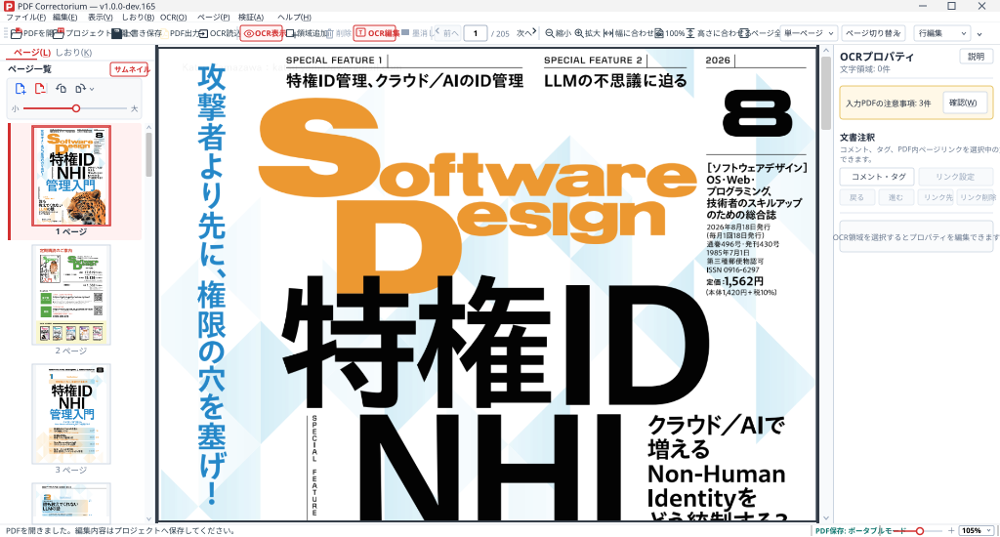
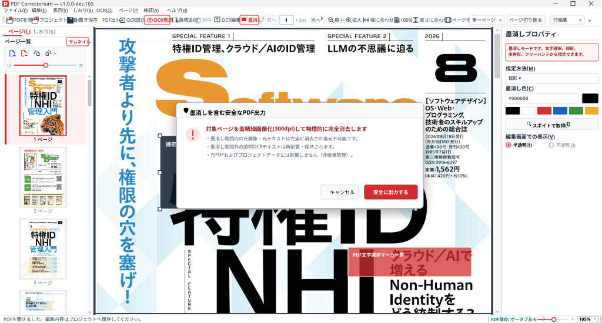
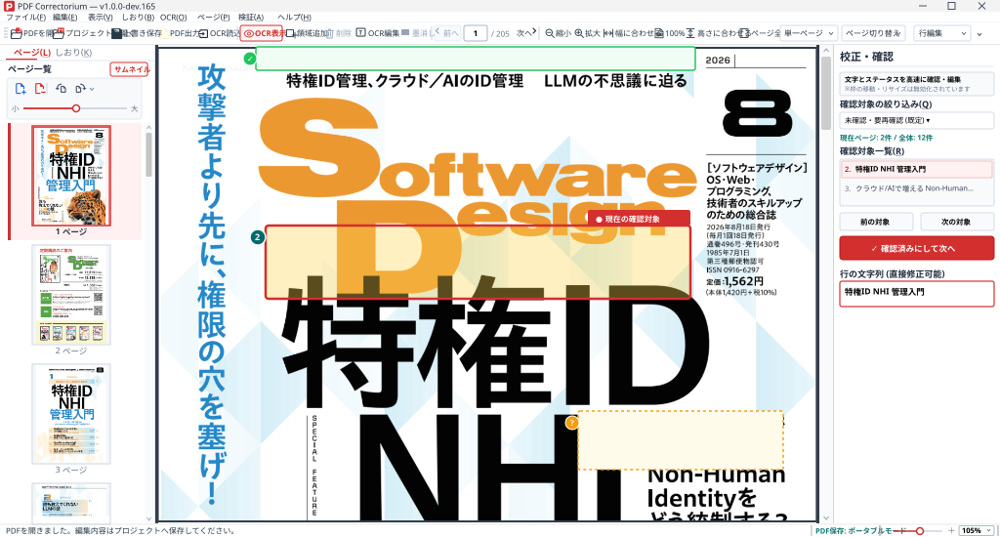

# PDF Correctorium

<p align="center">
  <strong>商用も完全無料・インストール不要。本物の墨消しと国会図書館OCR校正ができるWindows向け高機能PDF総合エディタ</strong>
</p>

<p align="center">
  <a href="https://github.com/Katsu2013/PDF-Correctorium/releases"></a>
  
  
  
  
</p>

<p align="center">
  <a href="#japanese">日本語</a> | <a href="#english">English</a> | <a href="https://katsu2013.github.io/PDF-Correctorium/">公式ウェブサイト</a> | <a href="wiki/Home.md">公式Wiki</a>
</p>

---

<a id="japanese"></a>

## 🚀 今すぐダウンロード（無料・インストール不要）

パソコンにインストールせず、USBメモリ等からもすぐに使えます。レジストリを汚しません。

| 配布ファイル | 対応OS | 形式 | ダウンロードリンク |
| :--- | :--- | :--- | :--- |
| **PDF Correctorium (最新ポータブル版)** | Windows 10 / 11 (64bit) | ZIPアーカイブ (容量はリリースページに記載) | 👉 **[⬇️ 最新版をダウンロード (.zip)](https://github.com/Katsu2013/PDF-Correctorium/releases/download/v1.0.0-dev.199/PdfCorrectorium-v1.0.0-dev.199-win-x64.zip)** |

### 🔰 3ステップで使えるクイックスタート
1. 上記リンクから ZIP ファイルをダウンロードします。
2. ZIP ファイルをお好みのフォルダーに解凍（展開）します。
3. フォルダー内の **`PdfCorrectorium.exe`** をダブルクリックするだけで即座に起動します！

> [!TIP]
> **完全ローカル処理による安心設計**  
> PDF Correctorium はすべての処理をお使いのパソコン内で完結します。ファイルを外部サーバーやクラウドへ一切送信しないため、**機密書類・契約書・個人情報を含むPDFも安全に編集・墨消し**できます。

---

## 📸 アプリケーション画面

<p align="center">
  
  <br>
  <em>直感的なサムネイル操作、多彩なツールバー、ドッキング可能なパネルを備えた作業画面</em>
</p>

<div align="center">
  <table>
    <tr>
      <td width="50%" align="center">
        
        <br>
        <strong>🛡️ 二度と復元できない「本物の墨消し」</strong><br>
        <sub>文字描画命令そのものを完全消去。スポイト機能・自動検証付き</sub>
      </td>
      <td width="50%" align="center">
        
        <br>
        <strong>✏️ 精密なOCR文字校正（NDLOCR連携）</strong><br>
        <sub>枠ズレ修正、縦書き・読み順整理、テンポよく確認できる専用モード</sub>
      </td>
    </tr>
  </table>
</div>

---

## 🌟 PDF Correctorium が選ばれる3つの理由

### 1. 🛡️ 二度と復元できない「本物の墨消し」（安全なマスキング）
- **黒四角を置くだけのソフトとは違います**: 見た目を塗りつぶすだけでなく、PDF内部の**文字描画命令そのものを完全に消去**します。コピペや文字検索で情報が漏洩する心配がありません。
- **多彩な指定方法**: 「PDFの文字を選択」「四角形」「自由な多角形」「フリーハンド（手描き）」から柔軟に範囲を指定可能。
- **自動検証機能**: 保存後に墨消し範囲内に文字データが残っていないかを厳格に自動検査して安全を保証します。
- **スポイト機能**: 書類の背景色と同じ色を取得して、目立たず自然にマスキングできます。

### 2. ✏️ 国立国会図書館「NDLOCR-Lite」連携 & 透明OCRテキストの精密校正
- **文字・位置・文字間隔を思い通りに修正**: 誤認識された文字の打ち直しはもちろん、枠の位置・大きさ・角度・文字ごとの間隔をマウスや数値で細かく調整可能。
- **日本語組版に完全対応**: 縦書き・横書きの混在や、文章を読む順番（読み順）を視覚的に整理できます。
- **専用の「校正・確認モード」**: 文字枠の誤ズレを防ぎながら、未確認の文字をキーボード操作やボタンでテンポよく連続チェックできます。
- **NDLOCR-Lite 連携**: 国立国会図書館の「NDLOCR-Lite」出力（JSON/XML）から高精度な文字枠データを取り込めます。

### 3. 📑 ページの並べ替え・結合・しおり作成・画質無劣化
- **ページの自由な整理**: サムネイルのドラッグ＆ドロップで並べ替え、90度回転、不要ページの削除。
- **他のPDFからページ挿入**: 別のPDFから必要なページを取り込んで結合できます。
- **写真・イラストの画質を100%維持**: 既存のページ画像を展開・再圧縮しないため、画質が一切劣化しません。
- **しおり（目次）と文書設定**: クリックで飛べる階層目次の作成、タイトルや作成者情報、PDFを開いたときの表示方法（見開き・左右綴じなど）を自在に設定。
- **元データを壊さない安全設計**: 元PDFを直接上書きせず、プロジェクト（`.pdfocrproj`）にいつでも保存して続きから再開できます。

---

## 💡 他のツールとの違い

| 比較項目 | 一般的な市販PDFソフト (Acrobat等) | Web上のオンライン編集ツール | **PDF Correctorium** |
| :--- | :--- | :--- | :--- |
| **利用料金** | 高額な月額/年額サブスクリプション | 無料枠あり（制限多数・有料誘導） | **完全無料 (Apache 2.0・商用利用可)** |
| **セキュリティ** | ローカル処理 | ⚠️ **外部クラウドへ文書を送信** | 🔒 **完全ローカル処理（外部通信ゼロ）** |
| **容量・回数制限** | なし | 厳しいファイル容量・回数制限あり | **制限なし（無制限）** |
| **墨消しの安全性** | 有料上位版のみ対応（高額） | 単なる黒塗り（裏文字が残る危険大） | 🛡️ **文字コード完全抹消＋自動検証** |
| **OCR透明テキスト校正** | 大まかな文字修正のみ | 非対応 | ✏️ **枠位置・字幅・縦書き・読み順まで精密校正** |
| **導入形態** | 重いインストーラー・要管理者権限 | ブラウザのみ（要ネット環境） | 🚀 **完全ポータブル（解凍して即使える）** |

---

## 📚 詳しい使い方・ドキュメント (公式Wiki)

さらに詳しい操作方法や活用ガイドは、[公式ドキュメント (Wiki)](wiki/Home.md) をご覧ください。

* 🔰 **[クイックスタート・起動方法](wiki/Getting-Started.md)**：ダウンロードから最初のPDF出力まで
* 🛡️ **[墨消し（マスキング）完全ガイド](wiki/Redaction-Guide.md)**：安全な機密保護の手順と注意点
* ✏️ **[OCRテキストの校正・編集](wiki/Ocr-Editing.md)**：文字枠・字幅の調整
* 🔍 **[校正・確認モードの使い方](wiki/Review-Mode.md)**：未確認テキストの効率的なチェック
* 📑 **[ページ編集・並べ替え・結合](wiki/Page-Editing.md)**：ページ構成の自由な編集
* 🔖 **[しおり・文書プロパティの編集](wiki/Bookmarks-Metadata.md)**：目次作成と表示設定
* 🇯🇵 **[国会図書館 NDLOCR-Lite 連携](wiki/Ndlocr-Integration.md)**：OCR認識結果の取り込み
* ⌨️ **[キーボードショートカット一覧](wiki/Keyboard-Shortcuts.md)**：効率的なキー操作
* ❓ **[よくある質問 (FAQ)](wiki/FAQ.md)**：トラブルシューティング

---

## 🗺️ 開発ロードマップと現在のバージョン

本プロジェクトは、**「日常業務で高価な市販ソフトの代わりに使える、実用的なオープンソースPDF総合エディタ」** の実現を目指して継続的に開発されています。

- **現在のリポジトリSnapshot**: `v1.0.0-dev.200`
- **現在の配布バージョン**: `v1.0.0-dev.199`

[dev.171からの変更点・互換性・検証結果](docs/releases/v1.0.0-dev.199.md)をご確認ください。

この開発スナップショットでは、元PDFの文書内リンク／HTTP(S)リンクを専用モードで表示・編集でき、文字選択または範囲指定から新しいリンクを作成できます。複数行の文字リンクは一括編集し、出力PDFでは行ごとのクリック範囲になります。ページ番号・ヘッダー／フッター・文字透かし、入力PDFの注意事項表示にも対応しています。日本語印字用フォントを同梱しています。画像透かしや危険なリンク動作の実行には対応していません。

[dev.200のリンク編集機能・互換性・検証状況](docs/releases/v1.0.0-dev.200.md)をご確認ください。公開済みの配布版は上記dev.199です。

ページ番号は表紙を除いて2ページ目から「1」にでき、奇数・偶数で位置を変えられます。設定画面の左右の簡易プレビューで配置を確認し、適用後は編集中のページにも表示します。

> [!NOTE]
> **💡 現バージョンで未対応の機能（今後の実装候補）**  
> 一般的な市販ソフトに備わっている以下の機能は、現バージョンではまだ対応していません：  
> - 既存本文テキストの直接打ち直し（OCR透明テキストではなく既存ベクターフォントの直接編集）  
> - 埋め込み画像の直接差し替え・リサイズ  
> - 蛍光ペン（ハイライト）・下線・電子印鑑・付箋メモなどの標準注釈（`/Annots`）  
> - パスワード設定・印刷禁止等のセキュリティ暗号化  
> - アプリ単体での新規OCR文字認識（外部NDLOCR-Lite連携のみ）  
> 
> これらの機能拡張計画については [開発ロードマップ (ROADMAP.md)](ROADMAP.md) をご覧ください。

---

<details>
<summary>🛠️ <strong>開発者向け情報・詳細な技術仕様・ビルド手順（クリックで展開）</strong></summary>

### 前提条件とビルド手順
Version 1.0の互換性基準として実行対象を.NET 8に設定し、Visual Studio 2026 / .NET 10の開発ツールでビルドしています。

```powershell
$env:DOTNET_CLI_HOME="$PWD\.dotnet-cli"
$env:DOTNET_CLI_TELEMETRY_OPTOUT="1"
dotnet build PdfCorrectorium.sln
dotnet run --project tests/PdfCorrectorium.ContractTests
```

ポータブル版の発行スクリプト：
```powershell
.\tools\BuildPortable.ps1
```

### バージョン管理方針
アプリの版番号は `Directory.Build.props` だけで定義します。必須の改訂・検証手順は [VERSIONING.md](VERSIONING.md)、今後の作業に適用するルールは [AGENTS.md](AGENTS.md) を参照してください。

### 安全性の修正と技術的詳細
- **文字選択の墨消し (dev.171)**: 編集画面で確認・保存したPDF座標の位置と大きさのまま出力。出力時に別矩形へ作り直さず、文字選択帯へ非表示の描画余白も加えない完全幾何学一致を実現。文字命令から文字符号のみを除去し、画像化フォールバックを行わずベクター構造を保持。
- **リソース管理と隔離プロセス (dev.159, dev.131)**: 大量ページの出力時に不要となったPDFiumのページリソースをチェックポイント方式で解放。qpdf本体およびPDF出力ワーカーにプロセスツリー終了とWindowsジョブオブジェクトによる資源制限（メモリ・プロセス数制限）を適用。
- **プロジェクト保存形式 (1.10)**: 元PDFを相対参照する「通常モード」と、元PDFを内包して単一ファイルで持ち運べる「ポータブルモード」を完備。複数範囲リンクとリンク表示状態も保存します。旧形式1.0～1.9を読み込めますが、1.10の読込にはdev.200以降が必要です。

より詳細なアーキテクチャやテスト戦略は [設計資料の目次](outputs/PdfCorrectorium-Documentation/README.md) を参照してください。

</details>

---

## 開発体制・クレジット

本プロジェクトの設計、実装、テスト、およびドキュメント作成は、OpenAI の **ChatGPT Codex** を活用したAIペアプログラミング・共同開発（Vibe Coding）によって行われています。

## ライセンス

[Apache License 2.0](LICENSE) のもとで公開されています。商用・非商用を問わず完全無料でご利用いただけます。第三者コンポーネントのライセンスは [THIRD-PARTY-NOTICES.md](THIRD-PARTY-NOTICES.md) をご確認ください。

---

<a id="english"></a>

## Overview (English)

**PDF Correctorium** is a free, portable Windows application for comprehensive PDF editing, secure irreversible redaction, bookmark/metadata management, and precision invisible OCR text proofreading.

<p align="center">
  <a href="https://github.com/Katsu2013/PDF-Correctorium/releases/download/v1.0.0-dev.199/PdfCorrectorium-v1.0.0-dev.199-win-x64.zip"><strong>⬇️ Download Latest Portable Release (v1.0.0-dev.199 .zip)</strong></a>
</p>

### Key Highlights
- **Operator-Level Irreversible Redaction**: Permanently eliminates underlying character codes and image pixels directly from PDF streams. Includes post-export automated verification guaranteeing 0 extractable characters remaining.
- **Precision OCR Proofreading & NDLOCR Integration**: Fine-tune bounding boxes, per-character advances, and vertical reading orders. Import OCR data directly from National Diet Library NDLOCR-Lite (JSON/XML).
- **Page Reorganization Without Quality Loss**: Reorder, rotate, split, extract, and merge PDF pages without recompressing existing images.
- **100% Offline & Safe**: Runs completely on your local machine. Never sends files or data to external cloud servers.
- **Fully Portable & Open Source**: No installation required. Runs directly from a USB flash drive or folder under the Apache 2.0 license.

See the [English Section in our Wiki](wiki/Home.md) for full documentation and user guides.
