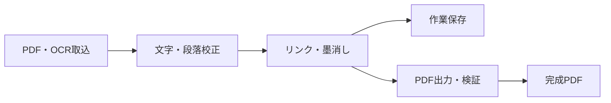
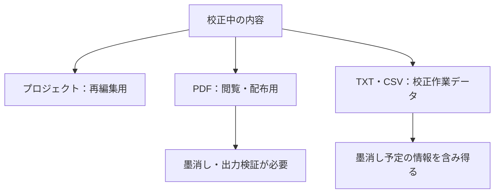

# 00-00 設計書の読み方と判断用マップ

## 最初に押さえる3点

- このアプリの中心は、既存OCR付きPDFの校正と安全な編集・出力である。
- アプリ公開版はdev.274。dev.275・276は文書変換と文書整理の改修で、アプリの再公開ではない。
- dev.277は外部レビューへの修正候補。公開済みアプリとは区別する。
- 以下は現在地の要約。制約と例外は各章の詳細で確認する。

## 目的から読む章を選ぶ

| 判断したいこと | 最初に読む章 | 詳細を追う章 |
|---|---|---|
| 何ができるか | 00-04 現行機能 | 01 要求・13 ロードマップ |
| どう操作するか | 02 UI/UX | 03 画面仕様 |
| OCRをどう直すか | 07 OCR | 05 データモデル |
| 何がPDFに残るか | 06 PDF | 08 プロジェクト形式 |
| 安全・軽快に動くか | 04 アーキテクチャ | 11 テスト |
| 公開・更新できるか | 12 運用 | リリース記録・90 ADR |

## 文書を扱う流れ

## 実装状態を読み違えないための区分

| 区分 | 代表例 | 判断時の注意 |
|---|---|---|
| 実装済み | 選択行の再OCR、類似語、段落、リンク、読み上げ | 対象条件と例外を各章で確認 |
| 実装計画 | 未OCRページ全体のOCR、縦書き混在の新規認識 | 現行アプリで使えるとは扱わない |
| 公開準備 | 署名済みMSIX、Store実公開・更新試験 | ZIPの公開実績と分ける |
| 履歴 | 過去の版ごとの成功件数・当時の制約 | 現在の再検証結果へ読み替えない |

## 保存形式の違い

- 確認用の枠やルビと、出力PDFへ保存される情報を区別する。
- 読み方情報は保存しても、全リーダーで同じ発音を保証できない。
- 更新内容は[dev.274の公開記録](../../../../docs/releases/v1.0.0-dev.274.md)、文書の書式は[執筆規則](../../../../docs/Documentation-Authoring.md)を参照する。
