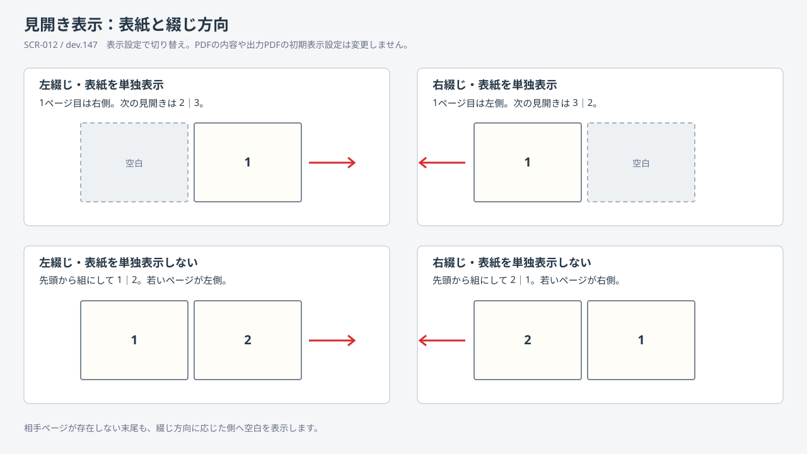
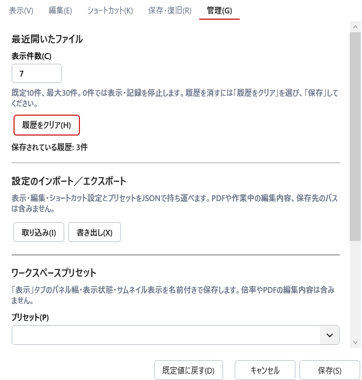

# 03-01 画面設計

<!-- CURRENT-RELEASE-SNAPSHOT -->
## 現行仕様（v1.0.0-dev.274・コミット前確認）

左右のドックはページ／しおりと、OCR・校正／リンク／墨消し／コメント・タグ／読み上げ。収納タブにはアイコンと文字を表示し、狭すぎる保存幅を補正して収納前の幅を引き継ぐ。後から開いたパネルも側の収納方針へ従う。×で閉じたパネルは表示メニューから復元する。

読み上げはヘッドホンボタンから開く。段落／行の前後移動・再生・一時停止・停止・音声・0.5刻み速度を持つ。PDF紙面はテーマで反転しない。現在の構成は[現行模式図](../../assets/svg/SCR-026_CurrentWorkspace.svg)。図は実画面のスクリーンショットではない。
<!-- END-CURRENT-RELEASE-SNAPSHOT -->

## dev.270の読み上げ段落

同じ段落に指定したChapterと1は、表示前後で同じ読み上げ単位として扱う。保存済み指定のまとめ直しは不要。操作や画面配置を追加せず、削除済み項目の誤った段落区切りを修正する。

## dev.269のPDF出力完了表示

読み方情報が保存された場合、完了画面に「保存した読み方情報: N行」と「外部リーダーでは、発音や区切りが異なる場合があります。」を表示する。新しい設定項目やコピー文字を変える選択肢は設けない。

## dev.268のPDF出力修正

画面・操作は変更しない。改行ハイフンの抽出マーカーで出力が停止する不具合を照合処理で修正し、本文や読み方は省略しない。

## dev.267のPDF読み方保存

読み方は本文と分離したPDFのAlt情報として保存し、確認用ルビは画面にだけ表示する。共通辞書と行例外の優先順位、文字・位置を維持する。MCIDとParentTreeで文字へ関連付け、実ファイルから再読込して検証する。墨消し情報を持ち越さず、無変更リンク等の重複処理を省く。対応リーダーでの実音声確認は別に行い、すべてのリーダーで有効とは主張しない。詳細はリポジトリの docs/Pdf-Reading-Export.md と docs/releases/v1.0.0-dev.267.md。

## dev.266の段落指定・収納操作

Chapterと縦書きの1は、方向・位置・ロックを保持して同じ段落へまとめる。「行ごと」の後も利用でき、外枠・編集・読み上げへ共通に反映する。無効理由は無効ボタンのツールチップで示す。パネルの収納は同じ側を一括、固定は選択パネルだけとし、左右の設定・固定例外を保持して後から開くパネルにも適用する。表示メニューは「このパネルを固定／同じ側をまとめて収納」とする。[仕様](../../../../docs/Chapter-Grouping-And-Side-AutoHide.md)。

## dev.264の段落外枠

OCRの段落編集では、共通の段落選択と同じまとまりを薄い外枠で囲み、選択行を含む段落を強調する。行枠・塗りを抑え、本文を覆わない。既存のOCR枠オンオフ・不透明度へ連動し、他の編集モードでは隠す。回転後の範囲・空の編集行・削除を扱い、行クリックは既存のままとする。[仕様](../../../../docs/Paragraph-Outlines.md)。

## dev.263の自動収納表示

左右端の短辺32pxのタブへ既存20pxアイコンと12pxの文字を表示する。アイコンは左右とも正立、ツールチップはパネル名。ネイティブのクリック・ピン・ドラッグとテーマを保つ。標準ピンとメニューで収納前の幅を継承し、ページ／しおり200px、プロパティ／読み上げ240pxを下限とする。狭すぎる旧保存値だけ補正し、有効な幅は再表示・再起動へ保持する。[仕様](../../../../docs/AutoHide-Tab-And-Width.md)。

## dev.262の共通読み方・ルビ編集・読み上げドック

読み方に「この行だけ／プロジェクト全体」を追加する。共通辞書を参照し、同じ表記の行指定を優先する。ルビはダブルクリックで小さな編集欄を開き、読み方と適用範囲を選んで登録する。文字・枠を動かさない。ヘッドホンボタンは独立した読み上げパネルを開き、狭い幅では操作を折り返す。左右端のタブへ自動収納し、ピンまたは表示メニューの固定／自動収納で切り替える。移動・収納時も再生位置を保持する。[採用仕様](../../../../docs/Shared-Readings-And-Docked-Speech.md)。

## dev.261の読み方入力と確認用ルビ

OCRプロパティの独立した「読み上げの読み方」に、表記／よみの2入力と登録・更新・削除、登録済み一覧を置く。連続文字選択を表記へ取り込み、同じ行内の一致箇所すべてへ適用する。横書きは上、縦書きは右の確認用ルビで表示し、枠表示とは別に切り替える。出力PDFには付けない。従来の一括入力は折りたたみ内に残す。座標・回転の詳細とは分ける。[操作・適用範囲](../../../../docs/Word-Readings-And-Ruby.md)。

## dev.260の読み上げ速度

速度は−5〜＋5、0を標準とし、スライダーと矢印キーで0.5刻みに調整する。小数値を表示・保存し、次の合成区間から反映する。音声一覧はWindows.Media.SpeechSynthesisで利用可能なWindows標準音声に切り替える。既知のDesktop名は対応するWindows音声があれば引き継ぐ。[仕様](../../../../docs/Speech-Fractional-Speed.md)。

## dev.259のコンパクトな読み上げウィンドウ

幅500、外周余白8の論理単位とし、高さは内容に合わせる。音声設定の折りたたみ時に空白を残さない。標準の×で閉じ、最大化・サイズ変更と下部の「閉じる」は設けない。再生・前後移動の32単位ボタンと既存アクセスキーは維持する。音声設定や長文は必要時に高さが増え、上限では縦スクロールを使う。

## dev.258の読み上げ開始ボタン

メインツールバーの右端にヘッドホン形の「読み上げ」を配置する。HasDocumentで有効化し、メニューと同じウィンドウ表示処理を使う。自動再生や重複ウィンドウを作らない。サイズ・ラベル表示・テーマ・アプリ共通の表示切替は既存のツールバーボタンと同じ方式とする。

## dev.257の読み上げ・手動段落

読み上げに前後ボタン、移動単位の段落／行選択、現在の段落・行位置を追加する。停止後も前後移動でき、一時停止中は音声を開始しない。OCRプロパティの段落指定は「まとめる／行ごと／自動」の3操作で、位置固定中でもメタデータを変更できる。既存アクセスキーとの衝突を避け、Alt+7／8／9を割り当てる。まとめる操作は連続する複数行に限定し、選択外の行を勝手に含めない。[操作と互換性](../../../../docs/Speech-Navigation-And-Paragraphs.md)。

## dev.256の読み上げ

同じ段落の折返し行はまとめて合成し、開始・停止・範囲選択の既存UIを維持する。音声の文字位置に対応する行へ一時マーカーを移す。音声ピッカーのツールチップで標準APIの範囲を示し、ナレーター専用Natural音声を利用できるようには見せない。段落推定でOCRデータや未保存状態を変えない。[仕様・制約](../../../../docs/Read-Aloud-Paragraphs.md)。

dev.255の更新メニュー：ZIPは実動作どおり「配布ページを開く」、直接配布MSIXは「更新を確認」。直接配布の確認中はその項目だけを無効にし、画面操作をブロックしない。更新なし・確認失敗・新版ありを区別する。新版への続行は既定「いいえ」の確認後、通常の未保存確認へ進み、キャンセル／保存失敗なら手配を破棄する。ウィンドウが閉じた後だけWindowsの更新画面へ渡す。自動更新はWindowsの背景処理、StoreはStore管理とする。[操作と制限](../../../../docs/Installer-Automatic-Updates.md)。

dev.254追補：文書未読込時でも「編集 → 設定」を開ける。文書依存の子項目は従来の操作制限を保つ。メニューのポップアップ、右クリック、入れ子、動的な最近のファイルへ共通テーマを適用する。NDLOCR読込アイコンはボタンの有効／無効の前景色を継承する。ツールバーの選択外枠、縦横の区切り、ドッキングの白い下地・枠は灰色系とし、赤い選択マークとPDF紙面は維持する。[修正・回帰試験](../../../../docs/releases/v1.0.0-dev.254.md)。

## テーマと読み上げ（dev.252）

設定の表示タブにテーマ（Windowsに合わせる／ライト／ダーク）を置き、保存後は既存ウィンドウへ反映する。PDF紙面、装飾の紙面プレビュー、墨消しの色見本はUI色へ置換しない。共通ブラシと標準スクロール動作を使う配色テンプレートで主画面・補助画面をそろえる。

「表示 → 読み上げ」は編集中も使えるモデルレス操作画面。範囲は選択部分／現在ページ／現在ページから最後まで、操作は再生・一時停止／再開・停止。音声と速度は展開領域へまとめる。アイコン操作に本物のアクセスキーとヒントを付け、下部の閉じるは文字だけとする。Escは再生中なら停止、停止中なら画面を閉じる。対象行の半透明マーカーは通常のOCR枠・文字選択から独立させ、終了・取消で消去する。[詳細](../../../../docs/Themes-And-Read-Aloud-Plan.md)。

## 共通OCR補正辞書（dev.243）

OCRメニューと類似語タブから「資料のOCR辞書」を開き、正解語・訂正ルール・無視語・頻出語（参照）の4タブで管理する。ルール表は有効／誤り／正解／自動許可を表示し、新規の自動許可はオフ。正解語と頻出語は分離する。フッターは保存・キャンセルの文字ボタンだけ。類似語修正と再OCR確認には、任意登録のチェックを未チェックで置く。

再OCRでは生値を保持したまま候補と理由を併記し、候補選択後も直接編集できる。認識結果への復帰は辞書補正前の値へ戻る。承認済み完全一致ルール以外は確認を省略しない。背景準備の表示は下部ステータスバーに限定し、前景処理・利用者操作のメッセージを上書きしない。背景更新で選択中の一覧を並べ替えない。

## 再OCRの画像確認と手修正（dev.242）

原画像は初期に縦横とも収まる倍率へ縮小し、小さな画像は勝手に拡大しない。拡大・縮小、Ctrl＋ホイール、100%、全体表示を備え、拡大時は標準スクロールバーで移動する。全体表示中はウィンドウサイズ変更に追従する。倍率変更でPDFを再描画／OCRしない。

候補は18 DIPの入力欄で編集し、現在の文字と赤い差分プレビューを併記する。認識結果へ戻すボタンを備える。差分だけ120msの遅延で更新し、タイピング中に画像調整しない。入力欄のEnterは未完成の候補を送信せず、適用は明示操作とする。空白だけ・制御文字・512テキスト要素超を適用不可にし、不正な貼付けは切り捨てず拒否する。フッターは文字ボタンのみ。

適用時に現在の候補で既存画像から文字幅を非同期調整し、元OCR・行高・回転・読み順を保持して1履歴へまとめる。処理中は入力を読み取り専用にし、閉じる操作で中止できる。古い行／文書・ロック・キャンセルを再確認する。正解辞書やモデル学習とは区別する。[仕様と将来案](../../../../docs/RapidOCR-Line-Recognition.md)。

## 列見出しの表示列メニュー（dev.241）

結果一覧5表は列見出しの右クリックで標準のチェック付きメニューを開き、各列を表示／非表示にする。列見出しの余白、一覧内のShift+F10／メニューキーにも対応する。チェック操作では閉じず、最後の可視列は残す。「既定の列表示に戻す」はVisibilityだけを既定へ戻す。列順・幅・並べ替え・選択・分析結果は保持する。データ行の右クリックは列メニューで奪わない。旧「詳細列」チェックボックスは撤去する。初期の基本情報と安全情報の選定はdev.238を維持し、表示設定は画面内のみ。[共通規約](../../../../docs/List-Presentation.md)。

## OCRプロパティのコンパクト化（dev.240）

「確認ステータス」と「文字方向」はラベル付きの2列とし、通常の各入力幅を約半分にする。画像調整は「行全体」「選択文字以降」のアイコン付き短縮ラベルを2列に置く。対象範囲・操作不可の理由はその直下に表示し、完全な操作名とヒントを維持する。文字サイズや既存の30 DIPボタン高さを縮めず、間隔は8 DIP。内容幅264 DIP未満は標準UniformGridの1列へ切り替え、コントロールの再生成・選択解除・再分析をしない。選択値の長文は折り返し、候補検索やアクセスキーの対象は維持する。行編集では選択文字以降の操作を非表示にする。[現行OCR配置](../../../../docs/UX-Ocr-Properties-dev216.md)。

## パネルを閉じる・再表示する（dev.239）

ページ・しおり・OCR／リンク／墨消し／コメント・タグのプロパティは再利用するツールパネル。×は非表示であり、内容を破棄しない。標準の可視変更イベントを1回にまとめ、表示メニューのチェック、アプリ設定、ネイティブ配置XMLを一致させる。表示メニューの1回のチェックで元のビューを再表示・選択できる。自動非表示はパネルを無効にした状態とは区別し、チェックを維持する。

非表示パネルが戻り先に使う空のワークスペース枠は破棄しない。既に戻り先を失った旧配置では記録された側へ復元し、他のパネルの再作成や文書読込を行わない。XMLからモデルが置き換わったらイベントを付け直す。起動だけでは隠した機能パネルを勝手に開かず、利用者のモード切替時の対応プロパティ表示は維持する。ツールバー本体は×で閉じられない設計を維持し、ボタンごとの表示は既存チェックリストを使う。[検証](../../../../docs/releases/v1.0.0-dev.239.md)。

## 一覧の基本表示と詳細列（dev.238）

最初に「対象を見分ける・判断する・操作する」情報を表示し、技術的な根拠は必要時に表示する（dev.241以降の操作は上記の列メニュー）。文字数外れ値はページ・判定・OCR文字列・文字数・目安文字数を基本表示とする。固定済みの表示をオンにした場合は基本の判定にも固定状態を残す。類似語の現在語・候補は16 DIPと差分強調を維持し、修正不可・ほかの候補ありを短く表示する。検索の一致位置番号、共通領域の座標は詳細へ移すが、本文の一致強調と適用可否は残す。

表示切替はその画面内の状態とし、プロジェクトやアプリ設定形式に保存項目を追加しない。既存列のVisibilityだけを切り替え、行・選択・ソート・分析を作り直さない。標準コントロールを用い、フッターの文字ボタンへアイコンを追加しない。フォントの埋め込み状態、入力注意の重大度・本文、自動リンクの移動先、墨消しの注意を既定で省略しない。画面別の基本／詳細／現状維持の判断は[一覧表示規約](../../../../docs/List-Presentation.md)を参照。

## 文字数外れ値の密度判定（dev.237）

「文字数の外れ値」タブを維持し、条件を「行の太さ許容差（%）」「最低比較件数」「密度比の閾値」とする。比較対象の行長は一致させず、横書きは幅／高さ、縦書きは高さ／幅で文字量を正規化する。「標準文字数」を対象行の文字種構成から推定する「目安文字数」へ変更し、ソート可能な「密度比」を追加する。原文字列・文字数・幅・高さ・方向・固定列、ジャンプと固定済みの表示切替は維持する。説明は条件と推定の意味を示す短文とし、常設のプロパティ説明を追加しない。画像再解析・自動訂正はしない。[仕様](../../../../docs/OCR-Character-Density.md)。

## 外れ値一覧とフォント通知（dev.236）

文字数の外れ値タブに「固定済みの領域も表示」を置く。初期オフで、領域全体の位置／サイズ固定のみを非表示にする。「固定」列と非表示件数を示し、分析結果・並べ替えを保持して再表示できる。画面を開いたまま固定を変えた場合とUndo／Redoも追従する。文字単位の固定だけでは行を隠さない。分析画面内の表示設定であり、プロジェクトを変更しない。

未埋め込みフォントの通常通知はOCRプロパティ内の確認ボタンで開く。透明文字専用と検証できたフォントには通知しない。文書プロパティのフォント一覧は省略しない。署名など他の注意、重大なフォント問題、検査失敗は上部の共通通知に残す。読み込み進捗は従来どおりステータスバーを用いる。

## 選択行の再認識（dev.230）

dev.233以降は、余白付き画像からの単一候補のみを表示・適用する。「別の画像条件での候補」は削除し、原画像・現在の文字・再認識候補の3段にする。内部でも旧1回目の認識は実行しない。dev.234では上下余白を拡大するが、その余白は適用する文字幅へ含めない。同一文字・画像で再実行しても範囲を拡大せず、実質無変更ならUndoも増やさない。

OCRプロパティとOCRメニューに同じ再認識アクションを置き、Restoreアイコンを共有する。認識は1行単位、通常の画像による文字境界調整とは別ボタンとする。dev.232以降、再認識の適用には行全体の画像による文字サイズ調整も含む。文字列が同じ場合も調整し、文字訂正とまとめてUndoできる。画像推定ができない時はステータスバーで知らせ、認識文字を破棄しない。読み取り順モード・他の編集モード・複数行・固定中の行では実行しない。横書きを初期対象とし、モデルが未検証の縦書きを自動補完しない。

進行状況・中止・完了はステータスバー。明確な補完は確認画面を開かず、補完箇所のマーカーとUndoを提供する。置換・削除・曖昧な追加は、原画像、現在文字、候補を同じ画面で見比べる。文字は18 DIP、異なるUnicode文字は赤・太字・下線で示す。ダイアログ下部の「候補を適用」「変更せず閉じる」は文字だけとし、フッターにアイコンを付けない。説明をプロパティに常時追加しない。[判定・安全条件](../../../../docs/RapidOCR-Line-Recognition.md)。

## 類似語候補とOCR行の配置調整（dev.235）

部分修正後、PDF上のOCR行を移動・サイズ変更・回転しても一覧・選択・並べ替えを維持する。配置だけのUndo／Redoでも再分析を要求しない。候補移動は現在の領域座標へ行い、既存の一致文字マーカーを維持する。新しいボタンや常設説明は追加せず、修正後の状態欄で「配置を調整しても続けられる」ことと、文字・固定・ページ変更では再分析が必要なことを示す。[現行仕様](../../../../docs/Similar-Word-Analysis.md)。

## 類似語候補一覧の並べ替え・可読性（dev.229）

現在の語／修正候補は16 DIP、初期列幅140 DIPとし、他の列・見出しの文字サイズは変えない。長い語は省略表示し全文をツールチップとコピーで確認できる。赤・太字・下線による差分強調を維持し、列の並べ替えは表示用Runではなく元文字列を対象とする。見出しクリックで昇順／降順、Shift併用の標準複数列ソートも妨げない。部分修正で一覧を更新しても選んだ並べ替えを維持する。全ページの再分析や自前のソート処理を追加しない。

## 一致箇所のマーカー（dev.228）

類似語・品質分析・検索から移動した一致キーワードに、半透明の黄色マーカーを表示する。通常のOCR枠やその不透明度とは別の移動先フィードバックであり、枠非表示・枠不透明度0%でも維持する。行全体は塗らず、対象のUnicode文字セルだけを塗る。次の候補への移動で切替、文字編集や検索強調解除で消す。プロジェクト・Undo・PDF出力には含めない。[仕様](../../../../docs/OCR-Overlay-Display.md)。

## 通常進捗とOCR枠の表示（dev.227）

リンク確認・PDF特性検査は下部ステータスバーに表示し、編集停止を伴う読み込み失敗と入力PDFの注意事項は上部共通欄に残す。「表示 → OCR枠を表示」は文字ではなく枠・塗り・ハンドルを切り替える。アプリ設定の表示タブで不透明度0〜100%を調整・保存し、初期値45%。設定プレビューでは文字を薄くしない。選択や文字座標・PDF出力・未保存状態には影響しない。[詳細](../../../../docs/OCR-Overlay-Display.md)。

## 類似語分析の継続操作（dev.226）

進捗バーは通常の割合表示で動き、完了時に隠れる。現在語・修正候補は異なる文字部分を赤・太字・下線で示し、コピーする値は原文字列。選択修正後は未修正候補と次の選択を残す。頻度は分析時の値と明示する。dev.235以降の失効条件は上記の入力世代に従い、配置だけの変更は継続できる。一般的な説明の常設追加ではなく、状態変化を短く示す。[dev.226時点の記録](../../../../docs/Similar-Words-UX-dev226.md)。

## 作業データ・ページ画像の出力（dev.225）

ファイルメニューの出力サブメニューからTXT／CSV／PNG・JPEGを選び、単一の共通ダイアログを開く。型に無関係な入力を隠すか無効化する。TXT/CSVは機密情報を含み得る常時警告、画像は全文書の検証済みPDF生成が先行する案内を表示。進捗・取消・完了先・失敗理由を示す。下部の書き出し／中止／閉じるは文字のみ、メニュー操作は共有Export。Tab移動は入力→下部操作、初期フォーカスは形式選択。文字列一括墨消しの既存画面には正規表現チェックを追加し、条件変更で旧候補を失効する。[設計](../../../../docs/Document-Exports-and-Regex.md)。

## 画像自動調整の点数不一致と局所境界（dev.215・現行）

行全体／選択文字以降の既存操作を使う。長い規則的な点線が1本だけ確実に見つかり、OCR点数との差が妥当なら、点線全体の実範囲を本文と末尾文字の基準にする。点数が違う場合は文字列を書き換えず、既存点文字を実範囲へ均等配置し、結果案内へ文字列／画像の点数を表示する。点文字1個ずつの字形一致を保証するものではない。本文境界の候補では局所位置に応じて幅の目安を更新する。

選択前の境界・固定文字・選択位置、1回のUndo／Redoを維持する。途中の字を勝手に選択してコマンドを連続実行しない。破断した点線、競合候補、不規則な間隔、大字形、大きな点数差はアンカーを使わず通常推定へ戻す。推定結果の確認は必要。新しい操作や説明の常設表示は追加しない。以下dev.214節の点数不一致時の扱いは過去仕様。

## 目次行の画像自動調整（dev.214）

既存の行全体／選択文字以降の自動調整操作を維持する。8文字以上の同一点文字と画像上の規則的な点線が一致する場合、点線を実測基準にして本文・ページ番号を独立推定する。選択文字は自動で次へ進めず、選択より前の境界と固定文字を維持する。1回のUndoでその操作を取り消せる。点線補正を適用した場合は結果の案内へ記載する。不規則な点線やOCR点数不一致は従来推定へ戻すため、結果の確認は必要。新しいボタン・ダイアログは追加しない。

## 機能別プロパティ（dev.213・現行）

プロパティはOCR・校正／リンク／墨消し／コメント・タグの4独立パネル。初期は右側タブ、ドラッグで分割・切り離し・左右配置できる。編集モード変更では対応するタブだけを選択し、位置を変更しない。タブ閲覧は編集モード変更とは別操作で、各編集パネルの切替ボタンから明示的にモードを変更できる。非表示は表示メニューから復元でき、標準配置へ戻す操作も用意する。

OCRの常設リンク6操作は廃止し、選択したOCR文字からリンク設定を開く入口のみ残す。リンク一覧・整列・ロックはリンクパネルに集約。コメント・タグは現在対象の本文とタグを表示し、既存ダイアログで編集する。任意説明の共通ON/OFF、ボタンの共通スタイル、アクセスキーとF6領域移動を維持する。入力PDF警告・読込案内はタブ外の共通領域に置く。後続dev.208節の「OCR内でも同じ6操作」は過去仕様で、本節が優先する。

リンクパネルの現行アクセスキーはAlt+K（編集）、W（範囲追加）、G（リンク先）、D（削除）、R（戻る）、T（進む）、X（枠固定）、U（自動作成）。単一ページAlt+N・ページ番号Alt+J・リンク枠表示Alt+Lとの競合を避ける。共通モード選択はAlt+M、パネル内の重複モードボタンはTab／Enterで操作し、別の全体アクセスキーを増やさない。リンク／墨消しの詳細入力は対応編集モードでのみ有効。

## 当時の画面の構成と共通操作（dev.208）

現在の機能一覧は[現行機能索引](../00_Project/00-04_CurrentImplementation.md)、手順は[UX](../02_UIUX/02-01_UXAndWorkflows.md)を参照する。後続のdev.204以前の節は当時の変更履歴であり、現在の形式・クリック操作・実装状態は本節を優先する。

- メニューの下にツールバー領域、その下に編集ワークスペースを置く。ワークスペースの左側にページ・しおりの独立パネル、中央にPDF編集、右側にプロパティを既定配置する。パネルはAvalonDockのタブ・分割・切り離しを利用し、配置を保存する。
- メイン／ページ表示の2本のツールバーは上下左右・浮動配置に対応する。ページ表示側へページ移動・番号入力・拡大縮小・フィット・単一／見開き・連続切替をまとめる。ツールバー領域はパネルの左右区切りにより中央幅へ縮めない。ページ一覧の外周左右余白とPDF編集外周の白い余白を縮小済み。PDF面の倍率やグレー背景とは別である。
- 編集モードはOCR編集、読み順編集、校正・確認、墨消し、リンク編集の5種類。初期値は「編集 → 設定 → 編集 → 新規文書の初期編集モード」。保存モードがあればそれを優先し、モード単独変更では未保存にしない。
- ツールバーの右クリックは項目別表示チェックを提供する。ボタンと入力を操作ID単位でアプリ共通保存し、全非表示時も表示メニューから復元できる。非表示の部品はTab対象にしない。
- 全モードで「説明」ボタンと`ShowPropertyHelpText`を共通使用する。19か所の任意説明はOFF時に余白ごと隠す。選択情報、読込状態、PDF注意、検証エラーは表示を維持する。文書注釈後の区切りはOCR関連モードだけに表示し、未選択OCRパネルの二重線を除去した。

### リンク編集プロパティ

指定方法、ページ内リンク一覧、移動先、選択数を示す。共有操作は「リンクを編集／リンクを削除」「リンク先／範囲で追加」「戻る／進む」の2列3段。OCR関連の文書注釈内でも同じ順序・アイコン・余白を使う。ロックは状態が分かるアイコンとラベルで示す。

整列はOCRと共通の小型ボタン（32 DIP、アイコン24 DIP）を用い、サイズ関連3個、水平3個、垂直3個の順で置く。最初に選択した矩形が基準で、OCR側の基準は変更しない。ロック中は削除も無効、移動先編集は可能。準備済みのページだけ操作し、枠未読込を「リンクなし」と表示しない。

Ctrl+クリックは複数選択、Alt+クリックは移動。Delは選択リンク削除（ロック中は禁止）、文字入力中は文字削除。リンクパネルのアクセスキーはAlt+K（編集）、N（範囲追加）、G（リンク先）、D（削除）、J（戻る）、R（進む）、L（ロック）、U（自動作成）。OCR関連パネルは既存入力との競合を避け、メニューアクセスキーとTab操作を利用する。

### 一括処理の確認ダイアログ

自動ページリンク、範囲繰り返し墨消し、文字検索墨消しは共通の`DocumentBatchWindow`を使用する。対象ページ範囲、必要な番号差／検索語、候補生成・中止、チェック付き候補一覧、選択ページのプレビュー、適用／キャンセルを備える。文字検索では大文字・小文字区別を指定できる。墨消し色はメイン画面の現在の色、範囲繰り返しは選択元の色・形状を使う。

一覧は仮想化し、画像は選択された1ページだけをプレビューする。候補は最大10,000件、無効候補は理由を示してチェック不可。条件変更時は候補と画像を無効化し、チェック済みの有効候補のみ一回のUndo単位で適用する。画像OCRや任意書式の目次解析を実施したと表示しない。

### 図版の版と役割

[現行構成図](../../assets/svg/SCR-025_WorkspaceAndBatch-dev208.svg)はレイアウト・状態保存・候補確認を説明する模式図であり、スクリーンショットではない。SCR-024等のリビジョン付き図と旧ワイヤーフレームは履歴資料。現行のCtrl／Alt操作、5モード、ロック、一括処理は本節に従う。

## dev.204の保存済みリンク初期化

保存済みのリンクは座標メタデータの準備前にモデル上へ存在するため、新しい読み込みの開始時に編集面の枠をいったんクリアする。準備完了ページの枠だけ再構成し、回転・CropBox原点の既定値で誤った位置へ描画しない。

内部リンクの指定座標へ移動する場合も、移動先ページの準備だけを待つ。待機中に文書／選択ページを変更したら、古いリンクのスクロール位置を反映しない。

## dev.203の表示ページ優先リンク読み込み

dev.201の「文書全体のリンク読込完了まで枠・編集を停止」を、ページ単位の準備判定へ変更する。現在ページと見開き／連続表示の表示面を優先し、準備できたページからリンク枠を表示する。リンク表示だけの場合はOCR操作を遮らず、リンク編集モードでは準備済みページを選択・編集・移動・削除できる。

ページ移動中に未読ページへ切り替えた場合はそのページを優先要求へ追加し、座標情報が届くまで編集を待つ。右ペインは「表示ページは編集可能／残りは読込中」と進捗ページ数を示す。読み込み完了をリンクなしと混同しない。

後続の未表示ページを読み込んだだけで編集中の枠を再生成しない。Undo／Redoでは操作で変更したリンクIDだけ復元し、後から発見したリンクを失わせない。保存・PDF出力・ページ構成変更は全ページ確認を待ち、途中失敗時は理由を表示して不完全な保存を止める。

文書単位でページ参照・継承座標・名前付き移動先をキャッシュし、繰り返しのページ描画ごとに全PDFを走査しない。通常のバックグラウンド走査は最大8ページ、表示優先要求は最大4ページの小分けとする。既存の実行中バッチ／参照解決が終わってから次の優先要求を処理するため、すべてのPDFで瞬時表示を保証する仕様ではない。

## dev.201の段階的読み込み

初期ページの準備後、リンクの読み込みと入力PDFの特性検査は文書単位のバックグラウンド処理とする。右ペインに処理段階を表示し、リンク読込中もページ移動・スクロール・拡大縮小を許可する。リンク読込中はリンク枠と編集操作を一時的に無効にする。リンク情報の準備ができたら編集を許可し、特性検査は独立したネイティブワーカーで継続する。

保存・PDF出力・ページ構成変更では必要な読み込み完了を待つ。元PDFのリンクを読み込めなかった場合は理由を表示し、不完全な状態で編集・保存しない。別の文書を開く／終了する場合は古い文書の処理を取り消し、その結果を新しい文書へ反映しない。

保存済みのリンク初期化情報を再利用し、注釈・アクションを毎回再取り込みしない。リンク設定のためだけに移動先ページの画像やOCRを生成しない。プロジェクト形式は1.10を維持する。リンクの複数選択・位置揃え・ロックは仕様確認待ちで、この変更には含まれない。

## dev.200のリンク編集

[リンク編集の操作図](../../assets/svg/SCR-024_LinkEditing-dev200.svg)

「リンク表示」と「リンク編集」は別の操作です。リンク編集モード中は枠を必ず表示し、右ペインに指定方法・ページ内リンク一覧・選択内容・編集／削除／移動を表示します。他モードのリンク枠はヒットテストを無効にし、OCR操作を遮りません。

- 選択：枠のクリックまたは一覧。複数行のどの枠を選んでも同じ論理リンクを選択する。
- 作成：文字を選択（可視PDF文字＋編集済みOCR）／矩形範囲を指定。
- 移動／サイズ変更：単一矩形リンクのみ。ドラッグ中は青い確定予定枠を表示し、マウスを離して一回のUndo履歴として確定。
- Ctrl＋クリック：安全なリンク先へ移動。通常クリックでは移動せず選択する。
- Del：選択リンクを削除。文字入力中は通常の文字削除。Esc：未確定操作取消→選択解除→OCRモード。
- 色：青（文書内）、紫（Web）、灰（編集対象外）。色だけでなく一覧・ツールチップに移動先／未対応理由を表示する。
- 文字リンクの行間はクリック対象にしない。画像のみで文字を取得できない場合は範囲指定を案内する。

見開き／連続表示の周辺ページにも表示枠を配置し、周辺ページの枠選択時は該当ページへ切り替える。表示方式の変更はドッキング配置を変更しない。

## dev.163の墨消し入力方法（2026-09-15）

- 墨消しプロパティの先頭に「入力方法」一覧を置き、矩形／PDF文字を選択／多角形／フリーハンドを選択する。Alt+Mで一覧へ移動できる。
- 多角形とフリーハンドの未確定輪郭は点線で表示し、確定済みの輪郭は保存色と選択枠を表示する。外接枠の中を一律に塗らず、実輪郭だけを塗る。
- PDF文字選択で該当文字がない場合は空の墨消しを作らず、ステータスで理由を示す。
- 既存の色、スポイト、表示濃度、一覧、削除操作は入力方法に依存せず共通利用する。

## dev.157の墨消し採色・Delete・ホイール操作（2026-09-13）

図: [墨消しのスポイト・Delete・未選択時ホイール](../../assets/svg/SCR-017_RedactionEyedropperAndWheel-dev157.svg)

- 墨消しプロパティの標準色候補の下に「スポイトで取得」を置く。アクセスキーはAlt+I、ツールチップは現在ページをクリックして色を取得することを説明する。取得待ちはボタンの選択状態と十字ポインターで示し、1回の取得またはEscで解除する。
- スポイトは現在の編集ページ内だけを対象とし、ページ外、画像未準備、寸法不成立では色を変更しない。取得した色は`#RRGGBB`で色入力へ反映する。
- 選択中の墨消しは、文字入力欄以外からDeleteで削除できる。削除後は選択を解除し、Undoで復元できる。入力欄では文字削除を優先する。
- 未選択時の通常ホイールは中央ワークエリアをスクロールする。Ctrl＋ホイールの倍率変更、および入力部品固有のホイール操作とは競合させない。

## dev.156の墨消し範囲の色・表示・削除（2026-09-13）

図: [墨消し範囲の色・表示・削除](../../assets/svg/SCR-016_RedactionAppearance-dev156.svg)

- ページ上の範囲をクリックするか、右ペインの現在ページ一覧を選ぶと、その範囲が選択状態になる。選択後の色入力と色候補は既存範囲へ即時反映し、Undo/Redoの1操作として記録する。未選択時は新規範囲の既定色を設定する。
- 「編集画面での表示」に「半透明」「不透明」を置く。半透明を既定とし、不透明は保存色をそのまま確認する。表示濃度は編集面だけの状態で、プロジェクト保存やPDF出力の不透明度には使わない。
- 範囲の中面を覆う移動用Thumbは透明テンプレートとし、既定部品の白背景を描かない。塗りは背面の墨消し表示だけが担当する。
- 右ペインの操作名は「選択範囲を削除」とし、編集メニューにも同じ個別削除を置く。削除はUndoで復元可能であることをツールチップに示す。

## dev.155の見開きページ切替（2026-09-13）

- ページ切り替え方式の見開き表示で前／次ページへ移動するときは、移動先の編集ページと相方ページを先に描画する。準備中は現在の完全な見開きを維持し、準備完了後に2つの表示枠を同じ画面更新内で置き換えるため、単一ページ表示へ一時的に切り替わって見えない。
- 準備中にページ選択、文書、単一／見開き、切り替え／連続、表紙、綴じ方向が変わった場合は、古い準備を取り消す。表紙または末尾に相方がない場合は従来どおりページ面を描かず、背景だけを表示する。

## dev.149の初回表示と表示状態保存（2026-09-12）

- PDF単体を開いた最初の画面は、文書プロパティの`PageLayout`と`Direction`をページ配置、スクロール方式、表紙、綴じ方向へ変換して表示する。指定がない場合は単一ページ・ページ切り替え・左綴じとする。
- ツールバー、表示メニュー、設定画面で利用者が変更した4項目は現在のプロジェクト固有表示として保存し、再読込時に文書の指定より優先する。初回状態を表示するだけでは保存要求を出さない。
- 文書のプロパティの「ページレイアウト」は1ページ、連続ページ、見開き、連続見開きを選択できる。連続見開きも既存の表紙・綴じ方向欄を使用する。新しい画面部品や配置変更はないため、見開き配置図はdev.147版を継続使用する。

## dev.148の編集プレビュー表示切替（2026-09-11）

- メインツールバーの「ページ配置」（Alt+N）と「スクロール方式」（Alt+2）、または［表示］→［ページ表示］から、単一ページ／見開きとページ切り替え／連続スクロールを独立して選ぶ。PDF未読込時は無効とする。
- 単一ページは現在ページの編集面だけを表示する。連続ページは先頭から末尾までを縦に並べ、スクロールバー、ホイール、タッチパッド等で切れ目なく移動できる。任意ページをクリックすると表示位置を保って、そのページがOCR操作可能な現在編集面になる。ページ一覧、前後ボタン等による明示的な移動は対象ページを画面内へ表示する。
- 見開き表示中は［表示］→［ページ表示］→［見開き表示の設定］を有効にし、「表紙を単独表示」、左綴じ、右綴じを変更できる。表紙の有無はAlt+C、左綴じはAlt+L、右綴じはAlt+R。設定画面の「表示」タブにも同じ設定を置き、1ページ目の単独表示はAlt+1、綴じ方向はAlt+J（綴じ／join）で操作する。
- 左綴じは組の若いページを左、右綴じは若いページを右へ置く。表紙を単独表示する場合、1ページ目は左綴じで右、右綴じで左へ配置する。先頭・末尾で相手ページがない側は位置だけ確保し、白いページ面・枠線・影は表示しない。同じ見開きに相手ページが存在するときだけ周辺画像を遅延描画し、クリックで編集対象を切り替える。
- 周辺画像は閲覧と移動に限定し、OCR枠、選択ハンドル、読み順番号は現在ページの編集面へだけ表示する。全ページ分の軽量枠は持つが、画像化するのは表示範囲と前後1画面に限定する。画像は最大12ページをLRU方式で保持し、高速スクロール、モード変更、文書変更で古い描画を取り消す。
- dev.148ではページ配置、スクロール方式、表紙の扱い、綴じ方向をアプリ設定へ保存していた。旧「連続ページ」設定は単一ページ＋連続スクロールへ移行する。dev.149では上記の文書初期値・プロジェクト固有値へ変更した。
- 幅・高さ・ページ全体へのフィットは、単一／連続では現在の編集ページ、見開きでは表示中の見開き全体を基準にする。連続表示で文書全長を高さへ収めることはしない。手動倍率は表示切替後も維持する。

## dev.143の論理ページ編集（2026-09-10）

削除・並べ替え・90度回転は、元PDFを複製せず論理ページ列とOCR座標を更新する。画面の操作、選択、Undo/Redo表示は従来どおりとし、プレビューとサムネイルは論理順・論理回転を反映する。サムネイルは現在ページの前後32ページだけを遅延生成し、離れたページへの移動時に周辺を読み替える。

## dev.142のページ履歴容量制限（履歴）

ページ編集用PDFは自動的に最大12ファイル・合計1 GiBへ制限する。上限で古いUndo履歴を整理した場合は、操作完了メッセージにその旨を付記する。新しい設定項目や常設表示は追加せず、通常操作の画面占有と設定の複雑化を避ける。ページ編集、Undo/Redo、保存の操作配置は変更しないため、画面図の改訂は不要である。

## dev.141のOCR描画負荷対策（2026-09-10）

文字ごとの画面部品を生成せず、1つのOCR領域を1つの描画レイヤーへまとめる。Unicode文字ごとの位置と送り幅、選択・ロック・検索一致の表示、倍率に応じた境界線、縦書き、読み順番号の最前面表示は維持する。領域サイズ変更用の8個のハンドルは、行／段落編集で選択中の領域にだけ生成する。選択解除、文字編集、校正・確認モードでは解放する。部品配置や操作は変更しないため画面模式図の改訂は不要。設計と検証方法は[OCR描画の軽量化](../../../../OCR-RENDERING.md)を参照する。

## dev.140で修正した読み順表示とdev.139以前の追加画面・部品

図: [プロジェクト保存・入力注意・コメント／タグ・ページリンク](../../assets/svg/SCR-011_ProjectAnnotations-dev133.svg)

- メイン画面右ペインに入力PDF注意バナーと「文書注釈」を追加する。文書注釈はコメント／タグ、リンク設定、戻る／進む／リンク先／削除を提供する。メニューからも同じ操作へ到達できる。
- プロジェクト保存設定画面は、別名保存先の指定後にポータブルモードと通常モードを選択する。選択肢ごとに移動・共有時の扱いを説明し、Alt+P／Alt+N、Tab移動、Enterで保存、Escでキャンセルできる。最大化・最小化は提供しない。
- コメント／タグ画面は対象名、コメント一覧、本文、重要度、タグ、解決状態を編集する。
- ページリンク画面は移動先ページ、任意倍率、説明を編集する。入力PDF注意画面はコード・重要度・見出し・説明・分類を一覧表示する。
- 追加画面も共通入力／ボタン様式、意味に基づくアクセスキー、Tab順序、Enter/Esc動作を使用する。
- 読み順編集の番号バッジは、PDF画像、OCR領域、選択枠、サイズ変更・回転ハンドルとは独立した最前面レイヤーへ描画する。バッジは入力を受け取らず、下にある領域の選択やドラッグを妨げない。不透明な背景と白い輪郭を使い、左上ハンドルや隣接領域の枠が重なっても番号を判読できるようにする。

## 旧ベースラインの画面と目標の区別（2026-08-30 / dev.123、後続改訂あり）

既存ワイヤーフレームと各画面の構成案はVersion 1.0の目標を含む。次の「現行実装」および設定画面の実装説明を、現在利用できる範囲として読む。

| 画面 | 現行実装と残る範囲 |
|---|---|
| メイン・OCR編集 | ページ/しおり、プレビュー、右プロパティ、状態編集、対象別コメント／タグ、OCR領域のページリンクを提供。補正方式・出力属性の専用UI、差分等は未実装 |
| 読み順編集 | 選択枠より前面の番号表示と読み順編集を提供。目標の階層ツリー・ルビ関連付け等がすべて揃った画面ではない |
| 検索・置換 | 検索、逐次置換、全置換を提供。目標の候補確認・条件指定の全項目は未完了 |
| 保存・検証 | 別名PDF出力、確定前検証、ポータブルモード／通常モードのプロジェクト保存選択、限定的な入力特性注意を提供。完全な適合性／署名検証マトリクスは未完了 |
| プロジェクト作成・診断修復 | PDF/プロジェクト読込、保存、検証、バックアップ復元は利用可能。作成ウィザードと分類型の修復・救出画面は未実装 |
| 校正・確認 | 現在ページの対象一覧・状態フィルター・ページをまたぐ移動を提供。階層別進捗集計等は未実装 |
| 文書のプロパティ | 文書情報、PDFバージョン、言語、初期表示設定の編集と解析情報表示を提供 |

### 共通部品の現行デザイン

アイコンの形状・サイズ・色・合成記号の離隔・適用判断は[アイコンのデザイン・適用基準](../02_UIUX/02-02_IconDesignAndUsage.md)を正本とする。画面ごとに別のPathや文字記号を新規作成せず、同一操作の共有形状をツールバー・メニュー・右クリック・プロパティ・ダイアログから参照する。新規の「←・→・−・＋」のフォント代用は禁止し、既存の未統一箇所は残件として区別する。

ダイアログ下部の操作ボタン列は、OK・保存・適用・既定値に戻す・実行・キャンセル・中止や同じ列の選択／前後移動を含めてアイコンなしとする（dev.211）。文字、既存のアクセスキー、Tab順、Enter／Escの動作は維持する。内容領域内の検索・削除等やメニュー・ツールバーの実行操作は共有アイコンを使い、複雑な操作の文字ラベルは残す。通常の閉じる、色見本、分類見出し、チェック／ラジオ選択も従来の除外を維持する。過去の監査表・版別適用数は履歴として扱い、現在の下部除外を実装漏れとはしない。

- メイン画面と文書プロパティを含む画面で共通のタブ、ドロップダウン、入力欄、ボタン、グループ枠のスタイルを使用する。タブは立体的な枠ではなく、選択項目をアクセント色の下線で示す。
- 編集可能なドロップダウンも同系統の枠・背景を使用する。状態、文字方向、校正フィルターの候補は日本語/英語の表示名を出し、言語切替時に選択値を維持する。
- ツールバーボタンは余白を抑え、パディング2 DIP、マージン1 DIPを基本とする。保存済みのサイズ設定とアイコン寸法を維持しながら主ボタンの外寸を4 DIP縮小する（最小24 DIP）。
- ステータスバーの拡大・縮小ボタンは通常時と無効時に枠を出さず、ホバー/押下時の背景とキーボードフォーカス表示を使う。
- しおり一覧のタイトル・ページ番号・編集欄は通常の文字の太さとし、行コンテナーには上下2 DIPの余白を設ける。行間隔は現状固定で、利用者が変更する設定はない。
- しおり追加と子しおり追加は、しおり形状に追加・階層を示す記号を組み合わせて区別する。100%表示は文書形状と「100」の表示を使い、ツールチップも付ける。

### アクセスキーの見直し（dev.126）

操作の意味に基づいて割り当てる。ファイルメニューはOpen=O、Save=S、Save As=A、Exit=X、設定画面はSave=S、Defaults=Dとする。追加・削除・前後移動・タブ・入力欄も英語名から選び、競合時は単語内の別の文字を使用する。意味のない連番で埋めず、関連する補助入力はTabで移動する。主要な割り当てとメニュー内の操作手順は[キーボード操作ガイド](../../../../KEYBOARD-ACCESSIBILITY.md)を参照する。Tab順序、F6領域移動、設定連動ツールチップは維持する。

### キーボード操作の追加（dev.125）

共通のアクセスキー・Tab順序・F6領域移動と、8種類の変更可能なショートカットのツールチップ表示は[キーボード操作ガイド](../../../../KEYBOARD-ACCESSIBILITY.md)に従う。入力見出しは対象の入力欄へ移動し、ボタン・チェック項目・タブは対応する操作を行う。OK・キャンセルにはアクセスキーを付けない。下部の操作ボタンへは入力欄の後にTabで移動する。文字編集には「前の文字」「次の文字」「送り幅を縮小」「送り幅を拡大」の専用ツールバー行を追加した。

## SCR-001 メイン画面

図: [ワイヤーフレーム (v1.0.0-dev.165)](../../assets/svg/SCR-001_MainWindow_Wireframe-v1.0.0-dev165.svg) / [旧版 (dev.139)](../../assets/svg/SCR-001_MainWindow_Wireframe.svg)

dev.139版の図は、プロジェクトのPDF保存方式を「ポータブルモード／通常モード」で示すステータス表示と保存設定画面、右ペインの入力PDF注意・文書注釈操作を含む。

構成: メニュー、コマンドバー、ページ/ナビゲータ、中央PDFキャンバス、プロパティ、下部ツールパネル、ステータスバー。中央キャンバスはPDFレンダリング画像と編集オーバーレイを別レイヤーで合成する。

### dev.153のOCR編集／墨消しモード切替

図: [OCR編集／墨消しの排他モード切替](../../assets/svg/SCR-014_EditingModeSwitch-dev153.svg)

- 上部ツールバーに「OCR編集」「墨消し」のモードボタンを並べ、右側の編集モード一覧にはOCR編集、読み順編集、校正・確認、墨消しの4項目を置く。ボタンと一覧は同じ選択値を表示し、PDF未読込時は無効にする。
- OCR編集では従来のOCR枠選択・文字・配置操作とOCRプロパティを使用する。墨消しでは十字ポインターによる矩形指定を使用し、追加後もモードを維持する。EscでOCR編集へ戻る。
- 墨消し中はOCR領域追加・削除・移動・サイズ変更・回転・整列・文字幅操作を無効にし、右ペインを「墨消しプロパティ」へ切り替える。OCR選択プロパティ、複数領域整列、未選択案内は表示しない。
- 墨消しプロパティには操作説明、色入力と候補、OCR編集で事前選択した文字・領域の範囲化、現在ページの範囲一覧、選択範囲の削除、ページ内一括解除を表示する。dev.156では編集表示の半透明／不透明も追加した。

### dev.154の墨消し範囲移動・サイズ変更

図: [墨消し範囲の移動・サイズ変更](../../assets/svg/SCR-015_RedactionResize-dev154.svg)

- 墨消し範囲の塗り面全体を移動用の操作面とする。選択すると四辺の中央と四隅に合計8個のサイズ変更ハンドルを表示し、方向に応じたポインターを使用する。
- ハンドルは選択中だけ表示する。範囲とハンドルはOCR枠より前面、読み順番号より背面に置き、墨消しモード以外では入力を受け取らない。
- 移動・サイズ変更はページ外へ出ないよう制限し、最小表示寸法を8pxとする。ドラッグ中は半透明範囲を追従させ、完了時に1回のUndo対象として確定する。
- 右ペインの範囲一覧とページ上の選択は同じ固定IDを共有する。一覧から選択した場合も同じ8方向ハンドルを表示し、Deleteキーまたは「選択を解除」で削除できる。

### dev.152の墨消し操作

図: [墨消し画面と安全なPDF出力 (v1.0.0-dev.165)](../../assets/svg/SCR-013_Redaction-v1.0.0-dev165.svg) / [旧版 (dev.152)](../../assets/svg/SCR-013_Redaction-dev152.svg)

- dev.152で選択文字／選択OCR領域／任意矩形の範囲化を追加した。当初の矩形追加フラグはdev.153で上記の排他的な墨消しモードへ置き換えた。
- 右プロパティに墨消し色の`#RRGGBB`入力、黒・白・赤・青・緑・黄の候補、選択範囲の追加、現在ページの範囲一覧、選択範囲の削除、ページ内一括解除を配置する。現在ページにある範囲数を表示する。
- 墨消し範囲はPDF画像・OCR枠より手前に半透明の選択色で表示する。範囲一覧の選択とページ上表示は同じ固定IDで対応させる。画面表示は確認用であり、PDF出力完了までは元情報を消去しない。
- PDF未読込、描画不能、出力中、バックグラウンド処理中は追加操作を無効にする。既存のUndo/Redo、Tab順序、フォーカス表示、共通のボタン／入力スタイルを使用する。
- PDF出力前に、選択した墨消し方式の影響と元PDF・プロジェクトに情報が残ることを確認表示する。任意範囲の画像化ではページの元描画・注釈が画像へ統合されるが、範囲外の不可視OCRは文字単位で保持する。PDF文字選択の直接編集では対象文字コードを除去し、未対応構造は出力を中止する。交差行を丸ごと消す仕様ではない。

目標のステータスバーにはページ、ズーム、モード、文字方向、OCRプロバイダー、未確認数、修正数、未保存状態を表示する。現行は操作メッセージ、プロジェクトのPDF保存方式、倍率操作等が中心で、目標の全項目を常時表示する実装ではない。PDF保存方式は`PDF保存: ポータブルモード`または`PDF保存: 通常モード`と明記し、文書未読込時は表示しない。アプリデータ保存モードはステータスバーへ表示しない。

### 文書未読込時の現行動作

dev.128の「ファイル → 最近開いたファイル」は未読込でも履歴があれば利用できる。最近の成功した読込を先頭に、PDF/プロジェクトを共通のサブメニューで表示する。ファイル名とフォルダーを表示し、長いパスは省略してツールチップで補う。履歴なし・表示0件・処理中は無効。Alt+F → R、矢印キーとEnterで操作する。

PDFが読み込まれるまでは、文書プロパティ、保存・出力、ページ/OCR/しおり操作、ページ移動・倍率等の文書依存メニューとコマンドを無効にする。ファイルを開く操作、設定、画面の表示設定、ヘルプは利用できる。PDF/プロジェクトの元PDFが読み込まれると有効になる。メニューだけでなく、対応するショートカットとダイアログ起動処理にも制限を置く。

dev.123では別文書を開く際にも保存確認を行い、読込失敗時には元の文書と編集を保持する。dev.129ではページ追加・削除・並べ替え・90度回転もUndo/Redo対象とし、操作前のOCR履歴、しおり、選択状態を保持する。その他の残件は[実装状況](../../../../IMPLEMENTATION_STATUS.md)を参照する。

### 表示倍率の現行動作

ステータスバーのスライダー、隣の倍率ドロップダウン、上部ツールバーの拡大・縮小・100%・フィット操作を同じ現在倍率へ同期する。ドロップダウンでの選択や直接入力の確定・取消後も同期を維持する。

| スライダー位置 | 倍率 |
|---|---|
| 左端～中央 | 25%～100%を線形に対応 |
| 中央 | 100%。縦の目安線を表示 |
| 中央～右端 | 100%～400%を線形に対応 |

軸はつまみの左右で色を変えず、単色の中立グレーとする。軸クリックはその位置へ移動する。左右でスケールは異なるが、矢印キーは1パーセントポイント、PageUp/PageDownは10パーセントポイントずつ倍率を変更する。

## SCR-002 OCR編集

図: [モックアップ (v1.0.0-dev.165)](../../assets/svg/SCR-002_OcrEdit_Mockup-v1.0.0-dev165.svg) / [旧版](../../assets/svg/SCR-002_OcrEdit_Mockup.svg)

右プロパティは以下を含む。

- 文字列: 原文、編集後
- 配置: X/Y/幅/高さ、始点・終点
- 変形: 補正方式、横/縦倍率、文字間隔
- 回転: 角度、中心、0度復帰、周辺へ整列
- 組版: 横書き/縦書き、進行方向、段落
- 属性: 検索、コピー、読み上げ、出力
- レビュー: 状態、コメント、タグ

## SCR-003 読み順編集

現行dev.140は、中央のOCR領域ごとに読み順番号を表示し、選択領域を前後へ移動する操作と位置からの再計算を提供する。番号バッジは全OCR領域と選択操作部品より手前に重ね、表示倍率に合わせて画面上の大きさを一定に保つ。背景は不透明、輪郭は白とし、マウス入力は透過する。

左または右の階層ツリー、自動推定の提案表示、グループ化、読み上げ対象外、ルビ関連付けはVersion 1.0の目標であり、現行画面には未実装である。

## SCR-004 検索・置換

検索条件、対象範囲、候補一覧、画像抜粋、文脈、置換操作、進捗を表示する。全置換と逐次確認を同一画面で切り替える。

## SCR-005 保存・検証

更新方式、フォント戦略、保存先、署名/PDF特性の警告を表示する。処理中は生成・構造検査・描画・文字検査の進捗を示し、完了後に正常/警告/エラー別のレポートを表示する。

## SCR-006 プロジェクト作成

元PDF参照/内包、OCR結果取り込み、OCR実行、プロジェクト保存先を段階的に選ぶ。外部送信を伴うOCRは別ステップで確認する。

## SCR-007 プロジェクト診断・修復

図: [ワイヤーフレーム](../../assets/svg/SCR-003_ProjectDiagnostics_Wireframe.svg)

ZIP、manifest、ページJSON、元PDF参照、履歴、キャッシュを検査し、自動修復可能/確認必要/復旧候補/修復困難に分類する。

## SCR-008 設定

一般、表示、OCR、編集、保存、プロジェクト、ショートカット、プライバシー、ログ、プラグイン、詳細に分ける。Portable/AppDataモードは「アプリデータ保存モード」として現在値と保存先を明示する。

dev.139では「表示」「編集」「ショートカット」「保存・復旧」「管理」の5タブを提供する。表示ではUI言語、ツールバー・パネル・サムネイル、OCRオーバーレイ、文字セル、文字幅調整ハンドル、領域サイズ変更ハンドルを設定できる。編集ではUndo履歴数と画像支援文字幅推定、ショートカットでは主要操作のキー割当、保存・復旧では自動保存間隔とバックアップ世代数を設定できる。管理では設定のJSON移出入と、固定パネル配置の名前付きプリセットを操作する。従来の保存先タブは管理内の折りたたみ項目へ移動し、「アプリデータ保存モード」と設定ファイルの場所を読み取り専用で表示する。OCR、プロジェクト修復、プライバシー、ログ、プラグイン、詳細の専用カテゴリは未実装である。

新しい部品も共通スタイル・意味に基づくアクセスキー・Tab順序に従う。インポート、配置適用、登録・更新・削除は下書きに対する操作で、「保存」でのみ本画面と保存ファイルに反映する。「キャンセル」は下書きを破棄する。[対象範囲・確認・形式制限・操作手順](../../../../SETTINGS-WORKSPACES.md)を参照。

dev.128では管理タブ先頭に最近開いたファイルの表示件数（既定10件、0～30件）、履歴クリア、保持件数／クリア予約の説明を追加。0件は表示・記録停止であり履歴削除とは別。クリアは確認を経て設定の「保存」で確定し、キャンセル・設定保存失敗時は実行しない。Count=C、History=HのアクセスキーとTab順序、共通入力・ボタンスタイルを使用し、管理タブは縦スクロール、下部の保存・キャンセルは固定する。詳細は[履歴操作ガイド](../../../../RECENT-FILES.md)を参照。

旧dev.127の[設定画面記録](../../assets/png/SCR-008_SettingsManagement-dev127-ja.png)は履歴として保持する。旧SVGはPDF作業画面の模式図であり、現在の設定画面の全項目を描いていない。現行の初期モード・ボタン表示・配置対象は本章先頭と設定ガイドを優先し、設計PDFの発行結果は文書更新記録を参照する。

## SCR-009 校正・確認（現行実装）

図: [校正・確認モードの模式図 (v1.0.0-dev.165)](../../assets/svg/SCR-009_ReviewMode_Wireframe-v1.0.0-dev165.svg) / [旧版](../../assets/svg/SCR-009_ReviewMode_Wireframe.svg)

上部ツールバーで「校正・確認」を選ぶと、右プロパティ上部に次を表示する。

- 「未確認・要再確認」（既定）、「未確認」、「要再確認」、「すべてのステータス」のフィルター。
- 現在ページの対象件数と、読み順番号・文字列を表示する対象一覧。削除済み領域は含めない。
- 「前の対象」「次の対象」「確認済みにして次へ」。確認済みにする操作は単一領域の選択時に利用できる。
- 該当なしの案内、および検索中の進捗と「検索を中止」。

対象一覧の選択と前後移動では、対象が見えるようプレビューをスクロールする。現在ページに対象がなくても別ページへ検索でき、文書端で循環しない。文字修正で一覧から外れても、選択中の編集欄は維持する。フィルターとモードはプロジェクトに保存しない。

通常の配置・文字幅・領域構造操作は無効にし、文字・単語の読み・確認状態を編集する。OCR品質分析のキーワード幅補正も実行不可とする。文字挿入/削除による通常の配置再計算は行うため、完全な配置ロックではない。全置換後は「要再確認」とする。操作と例外の詳細は[UX・操作フロー](../02_UIUX/02-01_UXAndWorkflows.md)を参照する。

## SCR-010 文書のプロパティ（現行実装）

図: [文書プロパティの模式図](../../assets/svg/SCR-010_DocumentProperties_Wireframe.svg)

文書読込後に開く所有者付きダイアログで、最大化・最小化・サイズ変更を行わない。概要、セキュリティ、フォント、カスタム、詳細設定のタブを共通の下線型デザインで表示する。ドロップダウンはメイン画面と共通のスタイルを使用する。

- 概要: タイトル、作者名、主題、キーワード、作成アプリケーション、PDF変換ソフトを編集する。作成日・更新日、ファイル情報、解析情報は読み取り専用。
- 概要内のプロジェクト情報: 現在のプロジェクトの「PDF保存方式」をポータブルモードまたは通常モードとして読み取り専用で表示する。アプリデータ保存モードは表示しない。
- 詳細設定: 元PDFバージョンの確認、出力バージョン（自動/1.4/1.5/1.6/1.7/2.0）、初期ページレイアウト、綴じ方向、表紙単独表示、文書言語を設定する。元PDFより低い版は選択できない。
- 文書言語: 読み上げオプションの候補選択とBCP 47形式の直接入力に対応する。音声選択や翻訳の機能ではない。
- 適用した編集値はプロジェクトの保存対象となり、PDFへの反映はPDF出力時に行う。元PDFをその場で上書きしない。

空欄指定とPDFへの反映先等は[PDF編集仕様](../06_PDF/06-01_PdfEditing.md)を参照する。

## 編集単位と説明の集約（dev.247）

編集単位の選択肢は段落編集／行編集／文字編集の順とする。SelectedIndexを内部の意味として扱わず、各項目の列挙値にSelectedValueで結び付ける。既存の内部番号と行編集の初期値は維持する。

画像調整の共通不可理由は1回だけ示し、異なる対象範囲や片方だけの不可理由は残す。OCR未選択は上部の現在対象に集約する。進捗と一般ステータスが同じときは進捗だけを表示し、PDF出力中は既存オーバーレイへ集約する。異なる警告・ステータス、処理終了後の通常表示を失わず、表示の都合で元のStatusMessageを消去しない。選択・状態だけの派生表示とし、画面走査やOCR再処理を追加しない。[変更・検証](../../../../docs/releases/v1.0.0-dev.247.md)。

## 単純操作のアイコンのみ表示（dev.246）

再OCRの拡大／縮小／全体表示／100%、反映候補プレビューの拡大／縮小／全体表示と候補前後、検索欄横の検索は、32 DIPのボタン内に既存18 DIPアイコンだけを表示する。内部操作名、日英のツールチップ、Altキー、Tab順序、無効・フォーカス表示を維持する。倍率値は残し、処理対象や意味を区別する操作・下部の確定／閉じる・利用者が設定したツールバーの説明は省略しない。[判断基準](../02_UIUX/02-02_IconDesignAndUsage.md)。

## 操作密度・余白（dev.245）

再OCR確認の画像枠は表示幅と行画像の縦横比で64～180 DIPとし、余剰高さを埋めない。初期高さは内容に合わせる。手修正文字18 DIPは維持し、入力欄34～76 DIP、差分表示最大54 DIPとする。狭い画面は本文側をスクロールし、適用／閉じるは固定フッターへ置く。画像の拡大・縮小・100%・全体表示とCtrl＋ホイールを維持し、表示変更でPDFの再描画や再OCRを追加しない。

共通の通常ボタンは内側8,3 DIP／外側2 DIP／最小高さ30 DIP。既存のツールバー専用サイズ、一覧行の文字・余白、歓迎画面の強調ボタン、アイコンの描画仕様を一律縮小しない。設定の外周・タブ内側は各12 DIP、節区切りは上下12／10 DIP。品質分析の外周12／タブ内側8 DIP、フィルター間隔6／10 DIP、OCR辞書の外周12 DIPとする。関連項目同士のまとまりは残す。下部確定・適用・キャンセル等にアイコンを追加しない。

## モックレビューで確定する項目

- dev.216：OCRは現在対象・固定状態→頻用操作／内容→折りたたみ詳細の順。画像調整の行全体／選択文字以降は文字付きボタンと作用範囲で区別する。長文は操作ガイドへ移し、入力エラー・安全通知は残す。[採用設計](../../../../docs/UX-Ocr-Properties-dev216.md)を参照。旧画面図がこの配置を示すものではない。
- 色、テーマ、アイコン、余白、最小画面サイズ
- ダブルクリックやホイール修飾操作
- パネルの既定配置と最小幅
- 一般的なPDF標準操作に準拠したショートカットの正確な対応表
