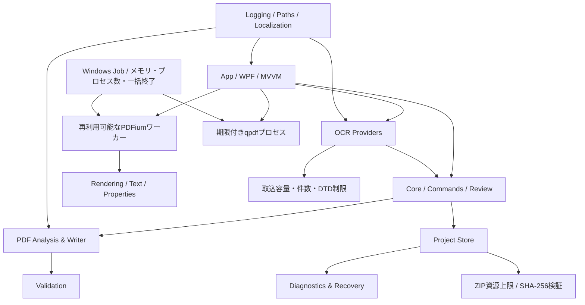

# 04-01 アーキテクチャ

<!-- CURRENT-RELEASE-SNAPSHOT -->
## 現行仕様（v1.0.0-dev.274・コミット前確認）

PDFium・qpdf・OCRは処理用ワーカーと入出力の検査を介する。表示ページを優先して残りのリンクを背景で確認する。RapidOCRは行用モデルと文書内の限定キャッシュを使い、認識余白を適用幾何から分離する。

OCR辞書は正解語・訂正ルール・無視語と、任意の頻度キャッシュを分離する。文字が変わらない配置修正だけで類似語分析をやり直さない。段落指定は編集・外枠・読み上げで共用し、削除済み項目を有効な読み順へ混ぜない。Windows音声はローカルで合成する。配布全件のハッシュ検査は開発・梱包時だけに行い、通常起動へ追加しない。
<!-- END-CURRENT-RELEASE-SNAPSHOT -->

## dev.270の読み上げスナップショット

読み込み済みOverlayからSpeechPageを作る際、ReadingOrderは削除済みを除いて構成する。TextRegionsには削除状態を保持し、SpeechTextで発話から除外する。非削除の読み上げ対象外行・墨消し・部分選択等の境界判定は変えない。全ページ解析や追加の音声準備処理は増やさない。

## dev.269の読み上げ方針

PDF出力処理は現行のAlt＋言語情報と再読込検証を維持する。音声用の語句置換はアプリ内読み上げに限定し、PDF本文・ToUnicode・ActualTextを読み方へ変換しない。辞書／音素情報の追加処理や全ページ走査は増やさず、完了表示と設計上の受入条件を更新する。

## dev.268の改行ハイフンの照合

読み方の文字対応付けで、PDFiumのU+0002をU+002D／U+00ADの代替として扱う。ほかの文字や制御文字を無視する正規化は追加しない。別のPDF保存工程・ページ走査・外部プロセスは増やさない。

## dev.267のPDF読み方保存

読み方は本文と分離したPDFのAlt情報として保存し、確認用ルビは画面にだけ表示する。共通辞書と行例外の優先順位、文字・位置を維持する。MCIDとParentTreeで文字へ関連付け、実ファイルから再読込して検証する。墨消し情報を持ち越さず、無変更リンク等の重複処理を省く。対応リーダーでの実音声確認は別に行い、すべてのリーダーで有効とは主張しない。詳細はリポジトリの docs/Pdf-Reading-Export.md と docs/releases/v1.0.0-dev.267.md。


## dev.266の手動段落と収納状態

共通分割では明示段落を方向の違いより優先するが、保護境界・部分選択・不正幾何は優先する。左右別の収納設定と個別固定例外を既存レイアウトXMLに任意属性で保存し、パネル変更を落ち着いたタイミングへまとめる。ネイティブコマンドの実行可否を継承し、同じグループにいたパネルでも固定は対象だけへ限定する。後から開くパネルはタブ生成後に内容を表示する。ビューと音声は再作成せず、全ページ処理を増やさない。[仕様](../../../../docs/Chapter-Grouping-And-Side-AutoHide.md)。

## dev.264の段落描画

OcrParagraphLayerは、現在ページの共通段落分割と回転後の外接範囲を1個の描画要素へキャッシュする。選択／ズーム／透明度は範囲を再計算しない。文字・幾何・方向・読み順・削除・段落指定の変更は次回描画へまとめて反映する。非表示・ページ切替では旧行の購読を解除し、全ページ走査・PDF再描画・出力への接続を追加しない。[仕様](../../../../docs/Paragraph-Outlines.md)。

## dev.263の自動収納幅

Parent変更前のモデル通知で固定幅を取得し、IsAutoHiddenへ移る際に共通の幅処理を使う。ネイティブのピンも対象とし、レイアウト復元では有効な保存幅を優先する。AutoHideWidth変更はネイティブホストからも保存へ通知する。モデル差替え時に購読を解除し、フレーム毎の計測や文書処理を追加しない。AnchorTemplateだけを差し替えてネイティブ操作を維持する。[仕様](../../../../docs/AutoHide-Tab-And-Width.md)。

## dev.262の共通辞書と読み上げの再利用

WordReadingMatcherはプロジェクト所有の不変な先頭文字索引を持つ。表示行は共通索引と行指定を照合して結果をキャッシュし、音声も同じ照合を使う。辞書の登録で全ページを読込・書換えない。ReadAloudPanelへ再生制御とUIを分離し、ドッキング先が変わっても同じインスタンスを保持する。Loadedの繰返しで音声を再初期化せず、アプリ終了時に取消・解放する。旧ネイティブレイアウトへ非表示の読み上げだけを追加して移行する。[仕様](../../../../docs/Shared-Readings-And-Docked-Speech.md)。

## dev.261の読み方照合とルビ描画

WordReadingRulesの構文・完全一致・最長優先を音声と表示で共用する。読み方と一致範囲は行内でキャッシュし、文字／ルール変更時だけ更新する。OcrCharacterLayerへ非操作の描画だけを追加し、語や文字単位のWPF要素・文書全体の再分析は増やさない。PDF出力処理には接続しない。[仕様](../../../../docs/Word-Readings-And-Ruby.md)。

## dev.260の小数速度対応Windows音声

WindowsMediaの合成器とMediaPlayerを遅延生成のSTAで扱う。約2,000文字以内の区間だけをメモリ上で生成・再生し、SpeechWordの再生時刻から既存の文字位置通知へ渡す。取消時は古いイベントを拒否し、購読・再生器・ストリームを解放する。System.SpeechをWindows SDK .NET投影へ置き換え、Windows APIターゲットは10.0.19041.0にする。以下のSAPI記述は従来版の記録で、現行は[小数速度の設計](../../../../docs/Speech-Fractional-Speed.md)を正とする。

## dev.257の共通段落と読み上げカーソル

SpeechParagraphs.Partitionを段落編集と読み上げで共用する。元のレイアウト文字列で分類し、読み仮名への置換で区切りを変えない。null／空GUID／非空GUIDのParagraphGroupIdをスナップショット、Undo、Core変換、保存・読込へ通す。語数・本文を変更しない指定を、PDF文字の配置変更へ転用しない。

SpeechNavigationは段落／行カーソルとページ境界を純粋に計算する。画面は現在ページの計画だけを保持し、合成ごとの取消とセッション全体の取消を分ける。移動要求は現在の合成を止め、一時停止は維持する。前後ページは必要時に取得し、古い合成のイベントを画面へ戻さない。[仕様](../../../../docs/Speech-Navigation-And-Paragraphs.md)。

## dev.256の読み上げ単位と進捗

CoreのSpeechTextは除外判定後の各行へ方向・親ID・境界情報を付け、SpeechParagraphsが読み順の隣接行だけを線形走査してまとめる。合成文字列のオフセットと元行を対応付け、進捗の行検索は二分探索する。既存の約2,000文字単位で合成し、STA上のSAPIイベントをUI Dispatcherへ渡す。画面側は取消・文書世代・現在の合成要求を検査し、古いイベントを破棄する。文書モデルの変更、全ページ走査、外部音声サービスを追加しない。[仕様](../../../../docs/Read-Aloud-Paragraphs.md)。

## dev.255の更新境界

`ApplicationPackageIdentity.ReadCurrent`がWin32の保護されたPackage IDを読み、`AppInstallerUpdateClient`が固定HTTPSの更新XMLを20秒・256KiB以内で取得／照合する。別発行元・別アプリ・DTD・ダウングレード許可等を拒否する。確認は画面の非同期処理で、PDFワーカーや起動の同期処理へ追加しない。`MainWindow.Updates`は終了予定を持ち、通常の保存／Closingの成功後にだけキャッシュの検査済みXMLをWindowsへ渡す。キャンセル・保存失敗・終了中の通信は取消す。静かな自動確認・ダウンロード・適用は埋込App Installer設定によるOSの責任であり、独自の置換エンジンを追加しない。[採用仕様](../../../../docs/Installer-Automatic-Updates.md)。

## dev.252の配色・音声の境界

`ApplicationThemeService` は共通色の役割を管理し、Windowsの設定通知を受けて動的リソースを更新する。周期的な全VisualTree探索やPDF再描画を行わない。標準のツールバー／スクロールの動作を保持して配色だけをテンプレートへ接続する。文書の色は配色リソースと分ける。

`SpeechText` は修正後文字・読み順・読み仮名・参加属性・墨消し交差を処理し、音声エンジンと独立して契約試験する。`WindowsSpeechService` は遅延生成するSTAスレッドへWindows SAPIを閉じ込め、UIスレッドを占有せず非同期に再生・取消する。ページ未読込時の文字取得は既存のAppContainerワーカーへ `speech-text` 操作で委譲し、画像を生成しない。モデルレス画面は文書世代・本文変更を監視し、古い再生を破棄する。マーカーは一時的なAdornerで、安定したOCR領域IDと通知へ追従する。[確定仕様](../../../../docs/Themes-And-Read-Aloud-Plan.md)。

dev.253では、読み上げの除外判定に編集後の枠だけでなく元座標と墨消し元領域IDも使う。未保存の取込行の元座標を編集後の枠で代用しない。墨消し予定がある文書の配置変更は古い対象判定を取消す。連続読みのページ移動では、対象の論理ページが実際に表示され、そのOCRの準備が完了してから発声を開始する。

## dev.250の配布・更新境界

dev.251では、見開きの準備結果にも連続表示と共通の文書・ページ対応判定を適用する。不可変プロジェクトの参照だけを判定せず、背景辞書更新を許容し、対象／相方のID・物理ページ番号・回転の変更を検出する。検査は対象2ページの定数時間の比較とし、全ページ・全文の再走査を追加しない。

アプリと隔離ワーカーの.NET 10.0.14を自己完結型へ固定し、同じペイロードからZIPとMSIXを作る。Store／App Installerが更新の実行主体であり、アプリは導入経路に応じて確認先を案内する。自動実行ファイル差替え、独自の常駐更新ポーリング、編集中の強制終了は追加しない。パッケージIDがあるときはportable.markerよりInstalled保存先を優先する。MSIX宣言はmediumILのpackagedClassicAppとrunFullTrustで、既存のPDF/OCR AppContainer隔離を省略しない。未署名Development MSIXと正式なStore／直接配布の公開条件を区別する。[運用手順](../../../../docs/Distribution-Operations.md)を参照。

## dev.249の基盤と保守境界

アプリ、Core、ProjectFormat、Infrastructure、契約・単独診断を.NET 10に統一する。PDFiumは158.0.8125、qpdfは12.4.2を採用し、TFMの選択で変わるAvalonDock／RapidOCR／TensorsのDLLとAvalonDockの日本語資源をロックする。親・AppContainerワーカーの処理境界、要求キュー、段階的読込、モデル・プロセス再利用は変更しない。管理DLLのロード対象は.NET 8向け資源でも実ランタイムは.NET 10となる。配布検証はruntimeconfigも確認し、実ロード先は起動ログへ記録する。[ADR-0008](../90_ADR/ADR-0008-NET10-Native-Dependency-Maintenance.md)を参照する。

連続プレビューは文書世代、ソースパス、ProjectId、ページ数、対象ページID・物理ページ番号・回転を照合してから画像を反映する。不可変プロジェクト全体の参照一致は条件にしない。背景のリンク読込・辞書キャッシュ更新で同一ページの画像が破棄されないようにし、画面付近だけの描画と最大12枚の保持上限を維持する。

## 分析座標と候補世代（dev.226）

PDF描画と分析モデルは共有のプレビュー寸法関数を使う。分析用の小画像から抽出した領域はキャッシュ投入前に通常表示座標へ変換する。後からモデル・Undoスナップショットを入れ替えない。候補には文書・セッション・編集状態に加え巻き戻らない履歴世代を持たせる。選択適用した非重複区間の累積文字数差を保持し、残候補を二分探索で更新・原文検証する。全文書再走査や候補同士の総当たりを避ける。差分は64文字以内・表示セルのみ。共通ProgressBarはPART_TrackとPART_Indicatorの契約を維持する。[詳細](../../../../docs/Similar-Words-UX-dev226.md)。

## 文書データ出力の責務分離（dev.225）

共通出力Windowは形式・範囲・進捗・取消だけを担当し、VMのDataExports部分クラスが現在の文書状態を固定して処理を調停する。DocumentDataWriterはPDF解析をせずストリームTXT/CSVと原入力保護・原子的置換を担当。PageImageExportServiceは検証済み完成PDFを隔離ワーカーへ渡し1ページずつ符号化する。処理専用PdfNativeWorkerClientだけが入力を1回ずつステージし、終了時は非同期破棄する。共通の表示ワーカーに大量画像出力を並べない。DocumentRegexSearchは全候補検索で共通の有界予算とUTF-16範囲だけを返し、既存の字形候補・レビュー・Undoへ接続する。[詳細・制約](../../../../docs/Document-Exports-and-Regex.md)。

## 実画像点線と局所幅基準（dev.215・現行）

Leaders部分クラスは画像の全連続成分を保持して低インク／細幅／等間隔の最大連続列を先に検出する。OCR点数に合わせた部分窓を検出範囲として扱わない。8点以上・点数比0.65〜1.35・候補1本を条件に外側半ピッチ境界を本文／末尾のアンカーとする。点数一致なら隣接点間の中点、不一致なら範囲内の均等境界を既存文字数に割り当てる。近傍の破断成分や複数候補は拒否し、隣接本文の推定失敗時も部分適用しない。原文の変更は行わない。

本文の動的計画法は候補直前の境界と残り文字の重みから局所的な目標幅を更新する。累積事前値はソフトなコストに変更し、最小／最大幅による実現可能範囲と有界の探索帯で計算量を抑える。英字の途中を境界に選びにくい最小幅・字種事前値を維持する。1回の画素投影を共有し、確定結果だけ既存ViewModelへ1回適用する。逐字コマンド反復・UI再描画ループ・全ページコピー・永続キャッシュは追加しない。アンカー不採用時にもこの局所推定を使う。以下dev.214節は導入時の履歴。

## 文字幅推定の画像アンカー（dev.214）

共通のCharacterAdvanceEstimatorに、OCRと画像成分の一致を条件とする点線アンカー処理を追加する。Leaders部分クラスが点線確認と区間分割、Pixels部分クラスが対象領域だけの画素コピーを担当する。回転補正した1回の投影を再利用し、本文・点線・末尾文字は各区間の幅と濃淡尺度で推定する。確定前に元モデルを変更せず、適用・ロック保護・履歴は既存OverlayRegionViewModel／ViewModelを使う。失敗時は通常の動的計画法へ戻し、コマンドを文字数回繰り返したりページ全体を再読込したりしない。画素ガードと回転／ページ端のサンプリング互換性を診断で検査する。

画像の座標は画素境界を表し、中心はn+0.5である。補正画像の中心から変換した位置へFloorを適用して最寄りの元画素中心を選ぶ。無回転で元の列・行が欠落しないこと、微小な座標誤差で半画素の丸めが反転しないことを検査する。行端の低インク全角文字を余白除去で捨てない。

## 独立プロパティと配置境界（dev.213）

`MainWindow.PropertyPanes`が既存XAMLの名前付き4セクションを初期化時に一度だけ独立したAvalonDockコンテンツへ移す。Window namescope、イベント、共有ViewModel、Undo、選択、ページ単位読込を保持する。タブ操作では文書のコピー・全ページ同期・再スキャンを行わない。コメント対象は論理ページ列の安定IDから取得し、コメント表示は該当パネル選択時だけ更新する。

ネイティブ配置は`XmlLayoutSerializer`で設定／プリセットへ保存する。読込前に`WorkspaceDockLayout`でサイズ・ContentId・数値・XML安全性を検証し、復元時に既存ビューをIDで再関連付けする。ドラッグ中の保存を配置の復元要求と混同しない。文書モデルとレイアウトを分離し、不正データは旧来の配置情報へフォールバックする。モデル復元時にはツールバーの浮動／ドッキングイベントも再接続する。

## 当時の編集・読込・候補処理境界（dev.209）

現行機能は[機能索引](../00_Project/00-04_CurrentImplementation.md)を参照する。以下の旧リビジョン節は導入時の記録。本節はdev.198〜209の追加境界をまとめる。

- 一括処理はページ単位の準備待機を共有する。中止トークンは待機だけを解除し、文書スコープの背景読込を中止しない。候補計算の背景処理には準備済みの回転と原点を不変の値として渡す。重複判定の既存リンクは当該ページの読込後に取得し、初期スナップショットより後の取り込みを落とさない。世代・文書ID・編集状態を処理前後で検査する。
- OCR追従リンクのロックは選択IDだけを対象に最新のページオーバーレイから座標を同期する。全OCRページの保存用再構築を要求しない。通常の保存時同期と座標変換は同じ境界を使う。

- 初期プレビュー、ページ座標／リンク読込、入力PDF特性検査を別の準備段階にする。文書スコープで中止・世代確認し、文書を切り替えた後に古い結果を適用しない。既存リンク初期化済みプロジェクトは保存データを再利用する。
- dev.203以降は現在・表示中のページを優先し、座標準備済みページだけリンクを表示／編集する。回転・CropBoxの仮座標で枠を出さない。文書単位のページ／オブジェクト／移動先索引を再利用し、毎回全文走査しない。通常8ページ、表示優先4ページのバッチ上限で処理する。
- 保存・PDF出力・ページ構成変更では必要な全体確認を待つ。部分的なリンク読込失敗をリンクゼロとして保存せず、プレビューを維持して理由を表示する。後続ページ読込で操作中の枠を再生成しない。Undo/Redoは変更対象のIDを復元し、後から見つかったリンクを消さない。
- `DocumentTextRunService`で文字列と字形座標を対応付け、自動リンクと文字検索墨消しで共有する。重い判定は背景処理で文書スナップショットを読み、WPF部品を背景スレッドへ渡さない。PDFページを1ページずつ処理し、候補を最大10,000件に制限する。
- `DocumentBatchWindow`と確認用候補を共通化する。画像は選択中の1ページだけ生成し、候補・画像をプロジェクトへ保存しない。条件・文書が変わったら候補を無効化し、チェック済みだけを一つの注釈Undo単位で確定する。
- `MainWindowViewModel.LinkLayout`に複数選択・整列・ロックの規則をまとめる。UIの無効化だけでなく編集処理でもロックと対象型を検査する。ページ外に出る整列は途中の枠だけ更新せず一括拒否する。
- AvalonDockがパネル配置と浮動操作を管理し、既存のページ／OCR／リンクViewModelはコンテンツを担当する。ボタン表示は安定した`ToolbarItem.Key`で管理し、表示切替やページレイアウト変更のたびにドッキング構造を作り直さない。
- アイコンは共有の凍結済みベクター資源、説明表示は共有スタイルを利用する。ただし、コマンド定義全体の完全統合や未設定アイコンの全件解消を実装済みと扱わない。

## dev.163の輪郭墨消し境界

- Coreの`PdfRedactionGeometry`へ、矩形互換輪郭、外接矩形、点包含、矩形交差を集約する。ViewModel、出力、出力後検証が別々の形状判定を持たない。
- WPFは入力軌跡と保存輪郭の表示を担当し、PDFポイント列だけを永続化する。フリーハンド点列はViewModelで間引き、描画中のマウスイベント数をそのままデータ量へしない。
- 出力は輪郭の外接範囲内だけを走査するスキャンライン塗りを用いる。ページ全画素と全頂点の直積処理を避け、矩形データは従来の高速な矩形塗りを維持する。
- PDFプレビュー結果はOCR編集領域とは別に、元PDFの可視／不可視文字境界を返す。文字選択はこの読取専用情報から墨消しを作り、元PDFオブジェクトを編集しない。

## dev.158の隔離出力境界

- 親プロセスは、現在のプロジェクトをそのまま非埋込保存しない。実際に出力へ使う準備済みPDFから、処理専用の相対参照、ファイルサイズ、SHA-256を生成した一時プロジェクトを作る。これにより、ポータブルプロジェクトの`relativePath=null`を通常モードへ誤変換せず、大容量PDFも二重に格納しない。
- 子プロセスは一時プロジェクトの通常の形式検証に加え、コマンドラインで明示された元PDFと記録済み指紋を照合する。論理ページ操作を実体化した一時PDFも、その実体を基準に再指紋化する。
- 状態ファイルの書込みはワーカー単位の直列化器を通し、毎回一意な一時ファイルを閉じてから原子的に置換する。進捗通知の完了を待ってから完了／失敗状態を書くため、古い進捗が終端状態を上書きしない。
- 保存先の確定は同一フォルダーの一時ファイルと処理固有バックアップを使って原子的に置換する。確定済み保存先を正本とし、その後のキャッシュ削除失敗は成功を取り消さない。

## dev.161の墨消し画像・OCR保持境界

- `PdfExportService`は墨消し対象ページの通常画像最適化を省き、編集済み表示内容から直接300 DPI・JPEG品質99の置換画像を作る。上限は長辺14,000画素・約96メガピクセルとし、画質改善が無制限なネイティブメモリ消費へつながらないようにする。
- 画像化前に、`Tr=3`または塗り透明度0のテキストオブジェクトのうち、1ポイントの安全余白を加えた全墨消し範囲と交差しないものだけを保持対象へ分離する。可視オブジェクト、交差する文字行、全注釈は従来どおり除去する。
- 出力検証はページ全体の文字数ではなく、PDFiumが返す各文字境界と墨消し範囲の交差を共通規則で判定する。範囲外OCRの有効性と範囲内情報除去を両立し、将来の保持対象拡張もこの境界へ集約する。

## dev.157のポインター入力と採色境界

- スポイト待機はViewの一時状態とし、ViewModelやプロジェクトへ独立フラグを保存しない。採色は現在の`BitmapSource`とページ表示矩形の座標変換だけで行い、OCR・墨消し・選択オーバーレイを描画し直した画像からは取得しない。
- 取得した`#RRGGBB`だけを既存の色変更操作へ渡す。選択中ならUndo可能な範囲色変更、未選択なら次回作成色となるため、採色専用の永続モデルや一時画像を追加しない。
- Deleteのルーティングは編集モード、選択墨消し、コマンド可否、フォーカス先を1か所で判定し、`TextBoxBase`・`PasswordBox`内では既定の文字削除を維持する。
- 通常ホイールは未選択時だけScrollViewerへ明示的に渡し、OSの行数またはページ単位設定を表示量へ変換して上下限で丸める。Ctrl＋ホイールの倍率変更とは先に分岐し、モード別実装を増やさない。

## dev.156の墨消し後編集と表示境界

- `PdfRedaction.ColorHex`はプロジェクトへ保存する出力色、`RedactionOverlayViewModel.ColorHex`は現在画面へ通知する射影とする。選択範囲の色変更は固定IDで永続モデルと射影を同時に更新し、注釈スナップショット履歴へ1回だけ記録する。
- 範囲選択はページ上のクリックと一覧選択を同じ`SelectedRedaction`へ集約する。個別削除もこの固定IDを用い、表示だけを消してプロジェクトに残す状態を作らない。削除・色変更のUndo/Redoは既存のプロジェクト注釈履歴を再利用する。
- 半透明／不透明は`RedactionPreviewOpacity`から導く一時的UI状態であり、`PdfRedaction`や保存形式へ追加しない。安全なPDF出力は従来どおりRGB色の不透明塗りで、編集表示の選択に依存しない。
- 移動用Thumbは入力だけを担当する透明なテンプレートとし、表示色・枠線は専用Borderへ分離する。これによりWPF既定テーマの背景色が墨消し面を覆う依存を排除する。

## dev.155の見開き遷移境界

- ページ切り替え方式の見開きナビゲーションは、選択ページを先に変更せず、移動先の編集ページを対話用PDFワーカー、相方ページを背景用PDFワーカーで準備する。
- 文書・現在ページ・表示設定が準備開始時と一致する場合だけ、選択ページ、編集用画像、相方画像を同一Dispatcherターンで反映する。準備中も現在の完全な見開きを維持し、単一ページの中間状態を描画しない。
- 新しい移動、文書終了、単一／見開き、切り替え／連続、表紙、綴じ方向の変更は専用CancellationTokenSourceで古い準備を中止する。完了・取消の両経路でトークンを解放し、結果やバックグラウンド処理を蓄積しない。

## dev.154の墨消し範囲変形境界

- `RedactionOverlayViewModel`は現在ページの表示座標と選択状態だけを通知する軽量な画面モデルとする。ドラッグごとに永続プロジェクトを複製せず、画面部品へ位置・寸法変更を通知する。
- WPF層はMoveおよびN/NE/E/SE/S/SW/W/NWの操作方向からページ内の候補矩形を計算する。ViewModelは候補をページ境界と最小寸法へ正規化し、表示側の防御だけへ依存しない。
- ドラッグ完了時だけ、表示座標をPDFポイントへ変換して固定IDの`PdfRedaction`を置換する。開始前後のプロジェクト注釈スナップショットを1組だけUndo履歴へ積み、連続Pointerイベントによる履歴・割当増加を避ける。
- キャンセル時は永続モデルから画面モデルを再生成する。OCR編集へ戻ると墨消しレイヤーのヒットテストを止め、OCR選択経路との入力競合を構造的に防ぐ。

## dev.153の排他的な編集モード境界

- `EditorInteractionMode`をOCR編集、読み順編集、校正・確認、墨消しの型付き状態としてViewModelに集約する。ツールバー、モード一覧、右ペイン、ポインター処理、コマンド可否が個別の真偽値を持たず、この1値から派生する。
- 墨消しモードでは`CanEditGeometry`と`CanAddOcrRegion`を偽にし、OCR変更コマンドを入口で拒否する。ビューのドラッグ処理も同じモード値で墨消し矩形へ分岐するため、表示と実処理のモード不一致を作らない。
- OCR文字・領域の事前選択はモード切替時に保持するが、墨消し中のクリックはOCR配置変更へ渡さない。墨消し追加後もモードを維持し、Escまたは明示操作でOCR編集へ戻す。
- 編集モードは作業方法を示す一時的UI状態であり、PDF内容・プロジェクトデータ形式・Undo履歴を変更しない。墨消し範囲自体だけを既存のプロジェクト注釈履歴へ保存する。

## dev.152の墨消し境界

- Coreの`PdfRedaction`は固定ページID、PDFポイント矩形、色と任意のOCR由来参照だけを保持する。WPFプレビュー座標、墨消し後画像、一時PDFは永続モデルへ入れない。
- ViewModelは選択文字／OCR領域／任意矩形をPDF座標へ変換し、コメント・内部リンクと同じプロジェクト注釈Undo/Redoへ積む。表示倍率や現在のプレビュー画像を正本にしない。
- `PdfExportService`は墨消し対象ページをレンダリングし、塗りつぶし後に元の可視オブジェクトと注釈を削除して画像1枚へ置換する。dev.161では文字境界を使って範囲外の不可視OCR文字を保持し、部分交差するテキストオブジェクトは範囲外の連続断片だけを再構成する。qpdfによる未参照オブジェクト整理とPDFiumによる範囲内抽出文字不在・再描画検証を通過した成果物だけを保存先へ確定する。
- 対象ページ単位の画像化は、PDF描画命令の種類ごとに安全な部分除去を証明する複雑さを避ける保守的な境界である。代償として注釈、構造タグ、ベクター品質を失い、範囲と接する文字行は行全体を除去する。この制約をUIと文書へ明示する。

## dev.151の対話処理と先読み処理の分離

- PDFiumは引き続き画面プロセス外で動かす。現在ページ、文字境界、文書情報など利用者が明示した処理は対話用ワーカーへ送り、サムネイル、隣接ページ、連続表示、検索・品質分析の走査は先読み用ワーカーへ送る。
- 各ワーカー内のPDFium要求は直列化し、プロセス間では独立させる。先読みのキャンセルや再起動が対話処理の通信境界へ影響せず、長い先読みキューがページ移動を待たせない構造とする。
- アプリ終了時は両ワーカーをWindowsジョブごと終了し、専用一時出力を回収する。UIスレッドはワーカー応答を同期的に待たず、診断経路も非同期で待機する。

## dev.148の直交するページ配置とスクロール方式

- アプリ設定をページ配置（単一／見開き）とフロー（切り替え／連続）の2軸に分離する。形式15までの連続ページ値は形式16で単一ページ＋連続スクロールへ移行する。
- `ContinuousPagePanel`は単一ページ行と見開き行を同じ仮想配置で扱い、実ページの矩形だけを描画する。欠けた側は綴じ位置を保つ幅だけ計算し、画面部品やページ画像を生成しない。
- 見開き行は`FacingPageLayoutCalculator`を再利用し、ページ切り替え表示と連続表示の左右規則を一致させる。画面部品と画像は現在ページおよび表示周辺の最大12ページに限定する。

## dev.147の見開き配置計算

- `FacingPageLayoutCalculator`を、現在ページ、総ページ数、表紙単独表示、綴じ方向から左右ページ番号を返す副作用のない規則として分離する。画面の左右配置と相手ページの遅延描画は同じ結果を使用し、条件分岐の重複による食い違いを避ける。
- 表紙単独表示時は1ページ目だけを綴じ方向に応じた外側へ置く。それ以外は2ページ単位で組を求め、左綴じは若いページを左、右綴じは若いページを右へ配置する。文書末尾に相手がない場合は欠けた側を空白とする。
- 設定変更では現在のPDF、OCRモデル、Undo履歴を変更しない。進行中の相手ページ描画を中止し、新しい組の相手が存在する場合だけ隔離PDFiumワーカーへ再描画を要求する。設定形式は15、プロジェクト形式は1.4のままとする。

## dev.146の連続ページ仮想配置

- `ContinuousPagePanel`は全論理ページの番号、基準寸法、縦位置だけを保持して文書全体のスクロール範囲を提供する。ページごとのWPF画面部品や画像を全件生成しない。
- 現在ページの既存編集面に加え、表示範囲と前後1画面に入るページだけを画面部品として生成する。補助画像はLRU順の最大12件とし、範囲外の画面部品は取り外す。
- スクロール通知は90ミリ秒へ集約し、古い描画をキャンセルする。描画は既存の隔離PDFiumワーカーを使い、UIスレッド上でPDFを処理しない。
- ページをクリックしたときは保留入力を確定し、既存編集面を対象ページ位置へ差し替える。ページ画像の複製やプロジェクトデータの変更は行わず、現在のスクロール位置と倍率を維持する。

## dev.143の論理ページ境界と保存境界

- ページ削除・並べ替え・回転は`ProjectPageReference`列への変更としてCoreモデルに保持し、元PDFを不変とする。プレビュー時は論理ページを元PDFページへ写像し、回転後の画像とOCR座標を表示する。
- PDF全体の実体化は外部ページ挿入、画像最適化解析、最終出力の境界へ集約する。削除・並べ替え・回転のUndo/Redoはプロジェクトモデルだけを復元し、作業PDFやサムネイルを複製しない。
- 形式1.4は`project.json`を唯一のJSON正本とし、ページ別JSON、元PDF参照JSON、サムネイルの重複保存を廃止する。内包PDFは既に圧縮済みであるためZIPの無圧縮エントリとする。
- QDF文字送り補正はマーク索引を一度のストリーム走査で作り、必要な周辺だけを解析し、置換箇所以外を順次コピーする。PDF容量に比例する大きな管理メモリを要求しない。

- `InputPdfInspectionService`はPDFiumで得る文書プロパティと、上限付きの先頭／末尾構造スキャンを組み合わせ、安定したコードを持つ注意事項へ変換する。結果はUI上の助言であり、PDFの完全な構文解析・署名検証・安全性判定とは区別する。
- コメント、タグ、内部リンクはCoreのプロジェクト集約に保存し、WPFの状態を直接シリアライズしない。ページとOCR領域の不変IDを参照して、ページ並べ替え後も移動先を追跡する。
- PDF出力時は既存のqpdfオブジェクト編集経路でLink注釈とGoTo移動先を追加する。元PDFの既存注釈配列は保持し、解決不能な本アプリ管理リンクは出力しない。
- 形式1.3のリンク型プロジェクトは、プロジェクト位置を基準とする正規化済み相対パスで通常の元PDFを直接参照する。絶対パスは保存せず、ルート付き・ドライブ指定・空要素・`.`を拒否する。埋め込みPDFからの変換とページ編集済み作業PDFだけを、内容ハッシュ名で隣接`.assets`へ永続化する。

## 1. 論理構成



上図のワーカーとqpdfは画面プロセス外で動作し、dev.131ではWindowsジョブによる資源・終了制約を受ける。ジョブは同一利用者トークンのままであり、AppContainer、権限縮小、独立サービスを示すものではない。

## 2. 推奨ソリューション

以下はVersion 1.0の目標境界である。現行ソリューションの物理構成は`PdfCorrectorium.App`、`Core`、`ProjectFormat`、`Infrastructure`および`ContractTests`であり、Rendering/Pdf/Ocr/Validation/Plugin.Abstractionsは独立プロジェクト化されていない。PDFium・qpdf・OCR取込・出力検証の実装は現在Appプロジェクト内のServiceへ集中している。

```text
PdfCorrectorium.App             WPF、View、ViewModel、ドッキング
PdfCorrectorium.Core            文書モデル、コマンド、Undo、レビュー
PdfCorrectorium.Rendering       PDF描画、座標変換、サムネイル
PdfCorrectorium.Pdf             解析、コンテンツストリーム、Catalog、保存
PdfCorrectorium.Ocr             共通OCRモデルとプロバイダー
PdfCorrectorium.ProjectFormat   .pdfocrproj、移行、復旧
PdfCorrectorium.Validation      保存後検証、レポート
PdfCorrectorium.Infrastructure  ログ、設定、パス、ローカライズ
PdfCorrectorium.Plugin.Abstractions 将来の拡張契約
PdfCorrectorium.Tests.*         単体、統合、ゴールデン、UI
```

## 3. 境界

- UIはPDFライブラリやベンダーOCR JSONを直接参照しない。
- CoreはWPF型に依存せず、座標と色は独自の値型を使う。
- ネイティブ依存はRendering/Pdf/Ocr実装へ閉じ込める。
- プロジェクト保存は論理モデルのスナップショットと操作ログを扱い、ViewModelを保存しない。

## 4. 主要インターフェース

```csharp
public interface IPdfRenderer { }
public interface IPdfAnalyzer { }
public interface IPdfWriter { }
public interface IOcrProvider { }
public interface IProjectStore { }
public interface IOutputValidator { }
public interface IApplicationDataPathProvider { }
public interface IClock { }
```

正確なメソッド契約は詳細設計で定める。すべての長時間処理は`CancellationToken`と進捗通知を持つ。

上記インターフェース群は設計目標であり、現行ソースには同名の共通契約は存在しない。独立プロジェクト化または本設計の改訂をVersion 1.0安定化前に判断する。

## 5. 編集方式

Commandパターンで編集を適用し、OCR編集レイヤーへ記録する。文字列と幾何の原値を保持し、画面プレビューは編集モデルから生成する。PDFは保存時のみ生成する。

現行dev.143のViewModelは、OCR領域差分とページ構成スナップショットを1本の時系列履歴へ格納する。ページ構成スナップショットは論理ページ列を含むプロジェクトモデル、元PDF参照、NDLOCR情報、ページ別OCR表示キャッシュ・寸法、しおり、表示ページ・複数ページ選択・OCR選択を保持する。再生成可能なサムネイルと、削除・並べ替え・回転用のPDF複製は含めない。固定ページIDとOCR表示モデルの参照を復元点で維持することで、ページ操作をUndoした後も、それ以前のOCR差分が同じ領域へ適用される。

外部ページ挿入だけは複数PDFを単一の新しい物理元PDFへ統合するため、ロック付き`PageWorkingFileStore`を使用する。挿入履歴の枝破棄、履歴上限、文書切替、終了で到達不能になったPDFを直ちに回収する。通常モードでその一時PDFを永続化する場合だけ内容ハッシュ名の`.assets`へ移す。論理編集だけなら安定した元PDFを直接参照し続ける。

## 6. 座標変換

画像ピクセル、PDFユーザー空間、ページ回転、CropBox、画面ズーム、領域ローカル座標を明確に分ける。変換は一箇所へ集約し、丸めは表示時のみ行う。

変換順序は、文字配置 → 文字間隔/伸縮 → ローカル整列 → 回転 → ページ座標配置とする。

## 7. 依存ライブラリ方針

PDFium系、PdfPig、qpdf、PDFsharp等は候補であり、採用は固定バージョンの機能・ライセンス・ARM64・配布物監査後にADRで確定する。MuPDF/iText/Ghostscript等のコピーレフトまたは商用条件はApache-2.0配布方針との適合を個別判断する。

## 8. 障害分離

外部OCRやqpdf等のプロセスは標準出力/エラー、終了コード、タイムアウト、キャンセルを管理する。dev.131では全qpdf経路を共通ランナーへ移し、5分の期限、出力量上限、キャンセル時のプロセスツリー終了を適用する。PDF出力ワーカーは30分を上限とし、Windowsジョブで子qpdfを含めて収容する。

PDFiumによるプレビュー、文字境界抽出、文書プロパティ読込は、画面プロセスとは別の長寿命ワーカーへ直列要求する。画像は上限付き一時PNG、構造化結果は上限付きJSONで受け渡し、出力先を専用一時ルート内へ限定する。通信行や結果の異常、ネイティブクラッシュ、応答断、期限超過、キャンセル時はワーカーを終了し、次回要求時に再生成する。PDFium 154.0.8035とqpdf 12.4.1の取得元・ハッシュはリポジトリ直下の依存ロックで固定する。
