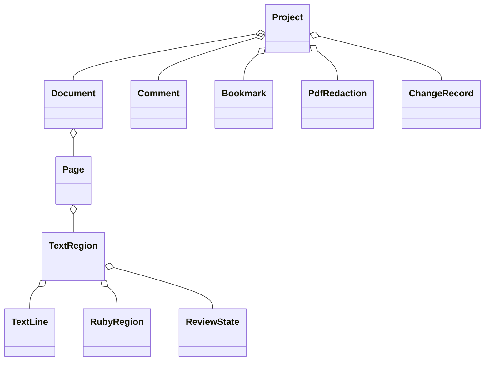

# 05-01 データモデル

<!-- CURRENT-RELEASE-SNAPSHOT -->
## 現行仕様（v1.0.0-dev.274・コミット前確認）

形式1.14／最小読取版dev.262、設定21。資料別OCR辞書（正解語・訂正ルール・無視語）、プロジェクト共通読み方、行ごとの例外、手動段落ID、リンクの幾何固定を保存する。頻度キャッシュは正解の根拠とは別にする。

手動段落はnull=自動、空GUID=行ごと、同じ非空GUID=同一段落。文字・位置・ロックを維持し、Undo／Redoと保存へ反映する。削除済み領域を保持しても、有効なReadingOrderには再挿入しない。OCR訂正辞書と音声の読み方辞書は用途が異なる。
<!-- END-CURRENT-RELEASE-SNAPSHOT -->

## 共通の読み方（dev.262）

PdfCorrectoriumProject.WordReadingsが共通辞書、OcrTextRegion.WordReadingsが行の例外となる。同じ表記は行優先、候補の重なりは最長優先で、曖昧な重複は勝手に選ばない。共通辞書は最大5,000件、表記・読みは各256文字以内、無効・重複・制御文字を保存前に検証する。共通辞書を既存の文書注釈履歴へ含め、行のUndoと区別して復元する。読み方の画面キャッシュは保存しない。形式1.14／最小読込dev.262へ更新し、設定21は維持する。

## 確認用ルビ（dev.261）

読み方は既存OcrTextRegion.WordReadingsに保存し、既存Undoスナップショットを共用する。ルビの描画座標・画面キャッシュは保存しない。設定21へ任意のShowWordReadingRuby（欠落時true）を追加する。表示切替はプロジェクトを変更せず、プロジェクト1.13／最小読込dev.257を維持する。

## 小数の読み上げ速度（dev.260・設定21）

任意のFineSpeechRateを0.5刻みのdoubleとして保存する。欠落時は従来の整数SpeechRateを使い、保存時にも整数の近似値を残す。EffectiveSpeechRateは計算値で保存しない。非有限値と範囲を正規化し、設定画面・移出入・同時起動のマージに保持する。プロジェクトへは格納しない。[互換性](../../../../docs/Speech-Fractional-Speed.md)。

## 手動段落（dev.257・形式1.13）

OcrTextRegion.ParagraphGroupIdはnullで自動、空GUIDで行ごとの独立指定、同じ非空GUIDで明示段落を示す。自動のnullは保存時に省略する。既存ParentRegionIdは保持し、同じページの連続する行へだけ明示グループを設定する。OverlayRegionSnapshotにも保持し、Undoで一括復元する。文字列・文字送り・幾何・ロック・読む順を変えず、語数キャッシュの全再集計を追加しない。[設計](../../../../docs/Speech-Navigation-And-Paragraphs.md)。

## 資料別OCR辞書（dev.243・プロジェクト形式1.12）

`PdfCorrectoriumProject.OcrLexicon`は正本の`OcrLexicon`。正解語、無視語、安定ID付き`OcrCorrectionRule`（有効・元語・正解・明示自動許可）を保持する。正解語と頻度は別である。`OcrWordCountsCache`はJsonIgnoreの任意データで、パッケージ内の別エントリへ保存する。アプリ設定やPDF出力へ転用しない。

`OcrLexiconIndex`は不変の共通検索索引、`OcrWordAccumulator`はページ／領域ごとに実際に計数済みの寄与を保持する。本文・削除変更だけ寄与を差し替え、位置・回転・固定状態は頻度を変えない。取り消し・やり直しでも非同期世代は戻さない。辞書だけの編集と、文字／配置＋任意登録の複合編集はそれぞれ既存履歴へまとめる。

## 配置保存の追加（dev.213・設定形式20）

`ApplicationSettings.WorkspaceLayoutXml`および`WorkspacePreset.WorkspaceLayoutXml`は任意のネイティブAvalonDock配置。アプリ全体のタブ・分割・浮動座標・非表示状態を保持し、プロジェクトには格納しない。上限65,536文字、200要素、既知9個の重複しないContentId（navigation／bookmarks／properties／link-properties／redaction-properties／comment-properties／main-toolbar／page-toolbar／editor）を必須とし、非有限・過大な寸法やDTDを拒否する。旧設定はnullで移行し、既存の左右・幅・浮動情報を利用する。プロジェクト形式1.11／最低読込版dev.206は変更しない。

## 当時のモデルの差分（dev.208／形式1.11）

`PdfInternalLink.IsGeometryLocked`は幾何と削除の保護状態である。ロック中は移動・リサイズ・整列・削除を拒否し、移動先や説明の変更は許可する。OCR領域に関連付いたリンクも、ロック中はOCR編集からの枠自動更新を停止する。解除後の追従と元注釈置換は従来の識別情報を使う。保護状態はUndo/Redoと保存・再読込に含む。

`PdfCorrectoriumProject.EditingMode`は任意の`ProjectEditingMode`（OCR編集／読み順／校正・確認／墨消し／リンク編集）。nullの旧プロジェクトは`ApplicationSettings.DefaultEditingMode`へ従う。通常保存で現在モードを記録し、モードだけの変更は編集内容の未保存フラグを立てない。`EditorViewState`は単一／見開き・スクロール・表紙・綴じ方向の状態で、別に管理する。

`ApplicationSettings.HiddenToolbarItems`は安定した操作IDの非表示リスト、設定形式は19。アプリ共通で、プロジェクトや名前付き配置プリセットのデータではない。説明の表示は`ShowPropertyHelpText`で全5モードに共通適用するが、選択情報・読込状態・警告・入力エラーは隠さない。

`DocumentBatchCandidate`は自動ページリンク／文字検索墨消し／範囲繰り返しの確認用データ。対象ページ、移動先、適用可否、既定チェック状態、プレビュー座標と適用結果モデルを保持する。確定したリンク／墨消しだけを既存配列へ加え、候補・画面画像はプロジェクトへ保存しない。最大10,000候補で、適用は一つのUndo操作とする。

文字装飾は`PdfTextDecoration`の種類、対象範囲、テンプレート、番号補正、通常位置、任意の偶数ページ位置、色・寸法・不透明度・余白で保持する。日本語フォントは同梱Noto Sans JPを使用する。コメント・タグ、論理ページ列、リンク識別、輪郭墨消しの既存モデルは維持する。[形式仕様](../08_ProjectFormat/08-01_ProjectFormat.md)と[現行索引](../00_Project/00-04_CurrentImplementation.md)を参照。

## dev.200で追加したリンクモデル（現行にも維持）

- `PdfInternalLink.SourceBounds`は元PDFの未回転座標での外接矩形、`SourceAreas`は行／列ごとの独立したクリック矩形です。表示時だけ回転とCropBox原点を変換します。
- `SourceAnnotations`は元注釈の参照、元矩形、任意の`/NM`識別名を保持します。元のオブジェクト番号はPDF再保存で変化し得るため、置換時は一意な矩形／名前の照合が必要です。
- `DestinationViewType`と`DestinationViewParameters`にXYZ／Fit系の移動先とnullパラメーターを保存します。`UnsupportedAction`付きリンクは表示のみで、編集・実行しません。
- `LinkOverlayVisible`はプロジェクトの明示的な枠表示設定です。`SourceLinkImportVersion`は取り込み移行用で、旧リンクIDと削除状態を維持して補完します。
- 複数矩形のPDF出力には標準Link注釈を用い、`/NM=pdfcorrectorium-link-<ID>-<index>`で再取り込み時に一つのリンクへまとめます。
- ページIDの解決は論理ページ列に依存し、OCRの遅延読込状態には依存しません。元のPDFと編集プロジェクトは非破壊です。

以下のdev.152等の節は当時の履歴です。既存PDFリンクの取り込み・編集、限定的な行末ページ番号候補化、編集モード保存は現在実装済みです。古い節の「含まない／保存しない」を現行の制限として使わない。

## dev.163の輪郭付き墨消しモデル

- `PdfRedaction.ShapeKind`は`Rectangle`、`TextSelection`、`Polygon`、`Freehand`を区別する。
- `PathPoints`はページ左下原点のPDFポイント列で閉じた輪郭を表す。矩形と旧形式は空配列を許し、その場合は`Bounds`を輪郭とする。
- `Bounds`は索引、表示配置、移動・変形用の外接矩形であり、非矩形の塗りや機密文字判定の正本ではない。
- 輪郭座標は有限、ページ内、3点以上、外接矩形一致を検証する。1件の上限は4,096点である。

## dev.152の永続モデル

- `ProjectPdfStorageMode`: `Embedded`または`Relative`。旧形式読込用の`Legacy`は正規化し、新規保存しない。
- `ProjectPageReference`: 固定`PageId`、不変元PDF内の`SourcePageNumber`、0／90／180／270度の`RotationDegrees`を持つ。`PdfCorrectoriumProject.PageSequence`の順序が表示・出力順である。
- `ProjectComment`: 対象参照、本文、重要度、解決状態、タグID、作成／更新UTC、任意の作者を持つ。現行UIの対象は文書、ページ、OCR領域。
- `ProjectTag`: 固定ID、名前、色を持つ。現行UIは名前の作成／割当を提供し、色編集は未実装。
- `PdfInternalLink`: 元ページID、任意の元OCR領域ID、任意の移動先ページIDまたはHTTP(S) `ExternalUri`、任意倍率、説明、有効状態を持つ。文書内リンクはページ番号ではなくIDで関係を保持し、OCR領域に依存しない矩形は`Bounds`を正本とする。
- `PdfRedaction`: 固定ID、対象ページID、ページ左下原点のPDFポイント外接矩形、任意の輪郭と入力種別、`#RRGGBB`色、任意の元OCR領域IDと文字範囲、作成UTCを持つ。プレビュー座標や一時画像を保存しない。

コメント／タグ／リンク／墨消し指定の編集は実行中のUndo/Redoへ入る。永続的な監査履歴、共同編集者管理、既存PDFリンクの取り込み、ページ番号の文字列自動認識は含まない。

## dev.123当時の実装制約（2026-08-30、後続改訂あり）

以下にはVersion 1.0の目標モデルを含む。領域レビュー状態と対象別コメント／タグは実装済みだが、階層別状態集計、監査履歴・ルビ関連付けUI等は未実装である。校正のモードと対象フィルターは一時的なUI状態であり、領域のレビュー状態とは別に扱い、プロジェクトには保存しない。

dev.123では`HasEditedText`で意図的な空文字を区別する。`HasEditedText=true`なら空文字も有効値で、旧形式の非空`EditedText`も読み込む。旧形式の空`EditedText`は従来どおり未編集として扱う。保存時は既存モデルを基に編集項目のみ更新し、親領域ID・補正方式・出力属性・方向属性を保持する。

## 1. 集約

## 2. 主要エンティティ

### Document

文書ID、元PDF参照、ページ、ViewerSettings、OCRプロバイダー履歴、フォント方針、検証履歴を持つ。

### Page

ページID、論理ページ番号、元PDFページ索引、MediaBox/CropBox、論理ページ回転、領域、読み順グラフ、状態集計を持つ。ページIDは並べ替えや回転で変えず、削除したページだけ論理列から外す。

### TextRegion / TextLine

- `OriginalText` / `EditedText`
- `OriginalGeometry` / `EditedGeometry`
- `WritingMode`: horizontal / vertical
- `FlowDirection`: ltr / rtl / ttb / btt
- `RotationDegrees`、`RotationCenter`
- ローカル矩形とページ上の四隅
- `HorizontalScale`、`VerticalScale`、`CharacterSpacing`
- `CharacterAdvances`: Unicode文字要素ごとの送り幅。横書きはローカルX方向、縦書きはローカルY方向の実長を保持する。
- `FitMode`: stretch / spacing / distribute / mixed / auto / positionOnly
- 段落、親領域、OCR由来、信頼度、言語
- 検索/コピー/読み上げ/PDF出力フラグ

### RubyRegion

表示文字列、読み文字列、本文領域ID、読み上げ・検索・コピー・出力属性を持つ。本文との関連がなければ読み上げ対象外を既定とする。

### ReviewState

`unreviewed`、`verified`、`modified`、`needsReview`、`excluded`、`deferred`。表示名はローカライズし、保存値は固定コードとする。

### ReadOrder

単純な番号だけでなくグループと子順序を表せる有向非循環構造を基本とする。循環は検証エラー。

### Comment / Bookmark

対象種別・ID、本文、状態、重要度、タグ、作成・更新時刻を持つ。個人名は将来の共同編集に備え任意フィールドとする。

### PdfRedaction

固定ページIDと有限・正面積の矩形を持つ。色は`#RRGGBB`に限定する。元OCR領域と文字範囲は操作由来を説明する補助参照であり、出力時の消去範囲は常に保存済み矩形を正本とする。対象ページが存在しない参照、ページ外矩形、不正色、不正文字範囲は保存検証で拒否する。出力用のページ画像は再生成物であり、プロジェクトへ重複保存しない。

### ChangeRecord

操作ID、相関ID、時刻、対象、変更種別、変更前後の要約を保持する。Undo用コマンドと監査履歴は別データ。

現行dev.143のUndo用ページ構成履歴は保存プロジェクト形式の`ChangeRecord`ではなく、実行中だけ保持する前後スナップショットである。削除・並べ替え・90度回転は`PdfCorrectoriumProject`内の論理ページ列、OCRページ、しおりと選択状態を対で保持し、OCR領域差分と同じ履歴順序へ積む。再生成可能なサムネイルやPDF全体はスナップショットへ含めない。外部ページ挿入だけは複数の物理PDFを統合した新しい元PDFを必要とするため、そのファイル参照を履歴へ持ち、枝の破棄、履歴上限、文書切替、終了で到達不能になった時点で回収する。プロジェクト保存後やアプリ再起動後にUndo履歴そのものを復元する機能、監査履歴として永続化する機能とは区別する。

## 3. 幾何モデル

水平AABBだけでなく、回転済み四辺形を保持する。回転中心と変換行列は倍精度で管理し、NaN/Infinity/ゼロ面積/ページ外を検証する。

## 4. 不変条件

- IDはプロジェクト内で一意。
- `PageSequence`のページIDは一意で、元ページ番号は元PDFの物理ページ範囲内、回転は0／90／180／270度である。
- `OcrPage.PageNumber`番目のIDは`PageSequence[PageNumber-1].PageId`と一致する。
- 元値は取り込み後に上書きしない。
- 編集値が未設定なら元値を有効値とする。
- 意図して空文字へ編集した場合は未設定と区別し、保存・再読込で原文を復活させないこと（dev.123で対応）。
- 読み順は循環しない。
- 出力対象文字列はUnicodeへ変換可能。
- 幾何値は有限で、面積が正。
- `CharacterAdvances`はすべて正の有限値で、要素数は有効文字列のUnicode文字要素数と一致する。文字幅情報がない旧データは行長を均等分割して補完する。
- 分割・結合は出自IDを残す。
- 墨消し範囲は存在するページを参照し、ページ境界内の正面積矩形と有効な`#RRGGBB`色を持つ。

## 5. 変更状態

編集操作に応じて`modified`へ移る。一括処理、段落再構成、読み順自動再計算など間接影響は`needsReview`にする。利用者は手動変更できるが、変更履歴へ残す。

通常文字修正は`modified`、全置換は`needsReview`とし、Undo/Redoと保存の対象とする。dev.123で全置換が`modified`になる不一致を修正した。独立した監査履歴と、その他すべての間接操作の状態遷移の網羅は未完了である。

## 6. シリアライズ

- JSONの列挙値は英語固定コード。
- 時刻はISO 8601 UTC、表示時にローカル化。
- 座標単位と座標原点をファイルに明記。
- 未知フィールドを破棄しない読み書きを検討する。
- スキーマバージョンごとの移行テストを持つ。
