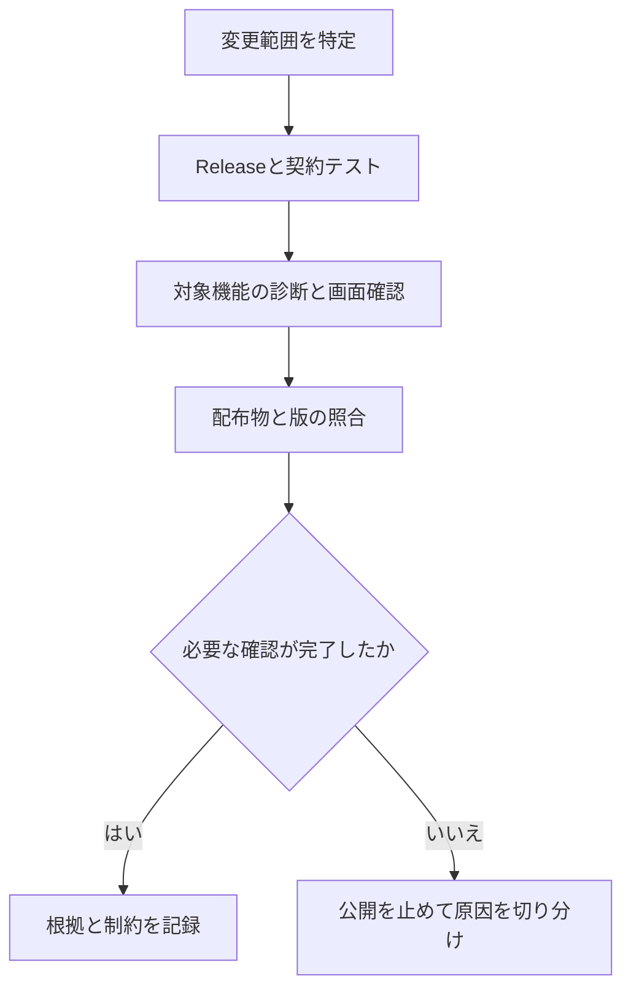

# 11-01 テスト戦略

## 最初に確認すること

- 「何を試すか」と「実際に成功した記録」を分ける。
- 以下は確認項目の整理であり、今回の文書修正でアプリを再検証した結果ではない。
- 公開版dev.274の結果は[リリース記録](../../../../docs/releases/v1.0.0-dev.274.md)を正本とする。
- 過去の成功件数・失敗と修正の記録は[版別の検証履歴](../../archive/records/11-01_TestStrategy-through-dev275.md)に保持する。

## 対象別の受入条件

| 対象 | 確認する操作・結果 | 失敗時の扱い |
|---|---|---|
| ビルド・契約 | Release全7プロジェクト、保存モデルと互換性 | 公開を止める |
| 保存と復旧 | 保存・再読込・取消・競合・バックアップ | 既存ファイルを保持 |
| OCR校正 | 文字境界、固定、再認識、差分、Undo/Redo | 不確かな変更を強制適用しない |
| 段落・読み上げ | 手動段落、前後移動、停止・再生、読み方 | 古いキュー・イベントを混ぜない |
| リンク | 既存注釈照合、追加、整列、ロック、遅延読込 | 未完了の読込で出力を確定しない |
| 墨消し・PDF | 選択範囲、残存文字、再描画、リンクと代替情報 | 安全に処理できなければ中止 |
| UI | テーマ、未読込時の設定、ドックの復元、枠表示 | モード間の不一致を記録して修正 |
| 隔離処理 | AppContainer、子プロセス、期限、取消、資源制限 | 部分結果を完成扱いしない |
| 配布 | 版、指紋、全ファイル、完成ZIP | 不一致なら公開しない |
| 新規導入・更新 | クリーンOS、署名済みMSIX、Store | 未実施を合格扱いしない |

## 確認の順序



## 実行時の注意

- リポジトリ直下から実行する。コマンドは[ビルド手順](../../../../README.md#build)を参照する。
- 診断ごとに新しい日時付き出力先を使う。失敗結果を上書きしない。
- 契約テストと、WPF画面・実PDFを使うアプリ診断を区別する。
- SDK上の単独診断と、配布物のプライベートランタイム上の動作を区別する。
- 利用者の提供文書を公開CIへ含めない。元資料のハッシュ不変も確認する。

```powershell
dotnet build PdfCorrectorium.sln -c Release
dotnet test PdfCorrectorium.sln -c Release
./tools/TestVersioning.ps1 -OutputDirectory <新しい検証出力先>
```

## PDF文書自体の確認

- Mermaidがコードではなく図として描画されていること。
- コードの背景・輪郭・字下げと、改ページ後の継続表示が正しいこと。
- 日本語・表・見出しがはみ出さず、必要なリンクが存在すること。
- 現行仕様・未実装候補・過去の実績が混ざっていないこと。

## 開発ソースのCI運用（dev.281）

- 出所をGitのクリーンなコミットとソース指紋で固定する。
- NTFS所有者を検証する試験は、試験データの実所有者も明示する。本番の削除条件は緩和しない。
- 音声診断は日本語音声を優先し、未導入なら導入済み音声を使う。音声が皆無なら失敗とする。
- CIはSynthesisOnlyで実WAV生成・速度差・取消・再利用を確認する。実再生は検証済みと扱わない。ローカルの既定NativePlaybackは進行キュー、一時停止・再開、再生中取消も確認する。プロファイルと範囲を結果へ記録する。
- アプリ診断21グループを最後まで実行して失敗を集約する。失敗が1件でもあれば成功報告や配布ZIPの確定へ進まない。
- 失敗時はPIDが一致する起動ログとfailure.txtを残す。過去の失敗記録は上書きしない。
- 実施結果は[dev.281記録](../../../../docs/releases/v1.0.0-dev.281.md)を参照する。設計PDFの生成はアプリ検証の代わりにはならない。
